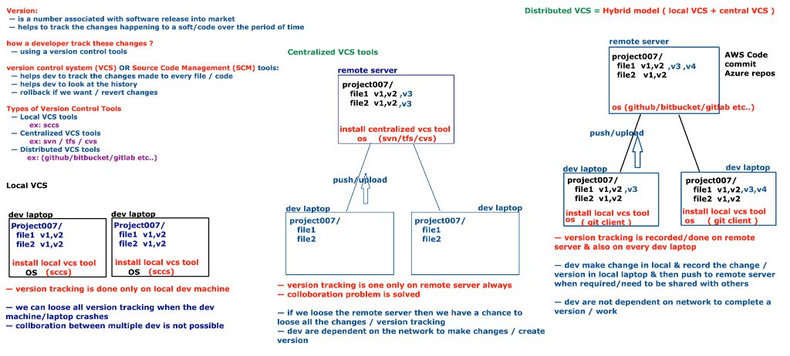
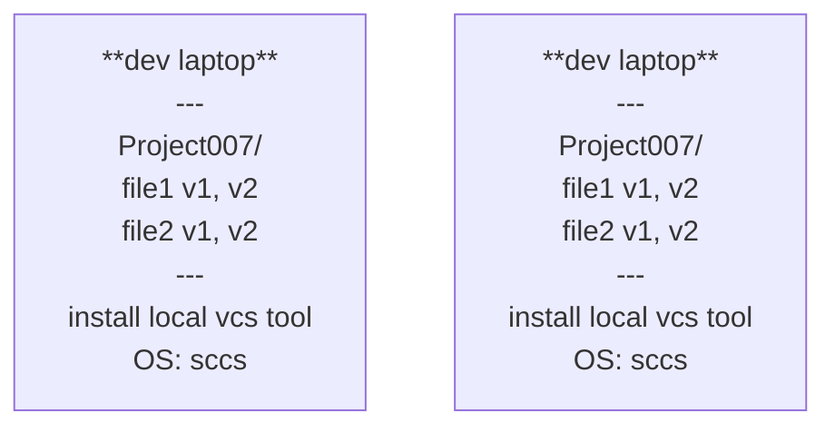
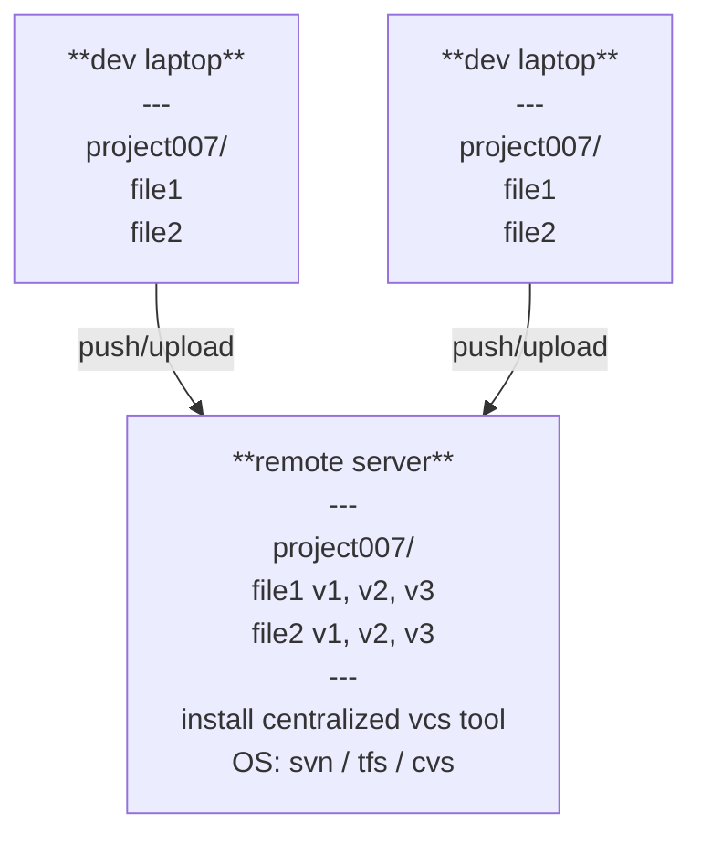
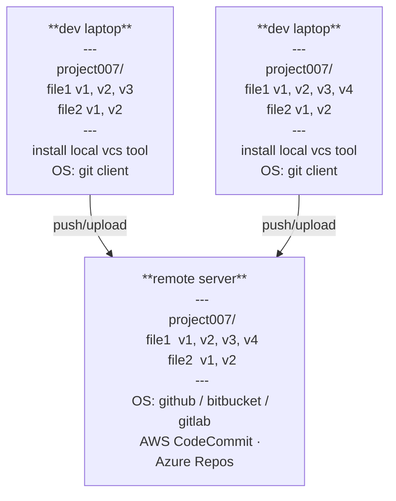

# Version Control System (VCS) — Introduction

> [!TIP]
> 🎮 **Interactive version available** — open [`vcs-intro-interactive.html`](./vcs-intro-interactive.html) in a browser for a step-by-step walkthrough of all three VCS types.

---

## Version

- Is a number associated with a software release into the market
- Helps to track the changes happening to a soft/code over the period of time

---

## How does a developer track these changes?

— Using a version control tool

---

## Version Control System (VCS) OR Source Code Management (SCM) tools

- Helps dev to track the changes made to every file / code
- Helps dev to look at the history
- Rollback if we want / revert changes

---

## Types of Version Control Tools

| Type | Examples |
|---|---|
| **Local VCS tools** | sccs |
| **Centralized VCS tools** | svn, tfs, cvs |
| **Distributed VCS tools** | github, bitbucket, gitlab |

---

## Local VCS

> [!WARNING] **Version tracking is done only on the local dev machine**
> - We can **lose all version tracking** when the dev machine/laptop crashes
> - **Collaboration between multiple devs is not possible**

---

## Centralized VCS tools

> [!NOTE]
> - ✅ Version tracking is done **only on remote server** — always
> - ✅ **Collaboration** problem is solved

> [!WARNING]
> - ❌ If we lose the remote server we lose **all changes / version tracking**
> - ❌ Devs are **dependent on the network** to make changes / create versions

---

## Distributed VCS = Hybrid model ( local VCS + central VCS )

> [!NOTE]
> - ✅ Version tracking is recorded/done on **remote server & also on every dev laptop**
> - ✅ Dev make changes locally & record the version in local laptop, then **push to remote server** when required / needs to be shared with others
> - ✅ **Devs are NOT dependent on the network** to complete a version / work
