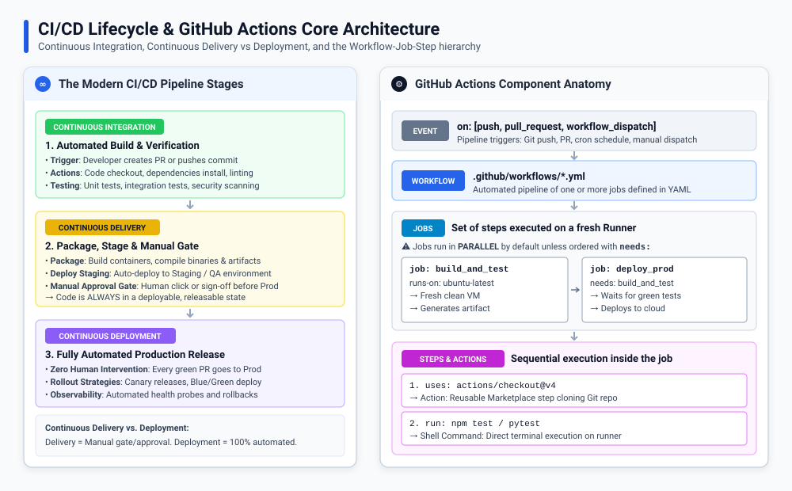
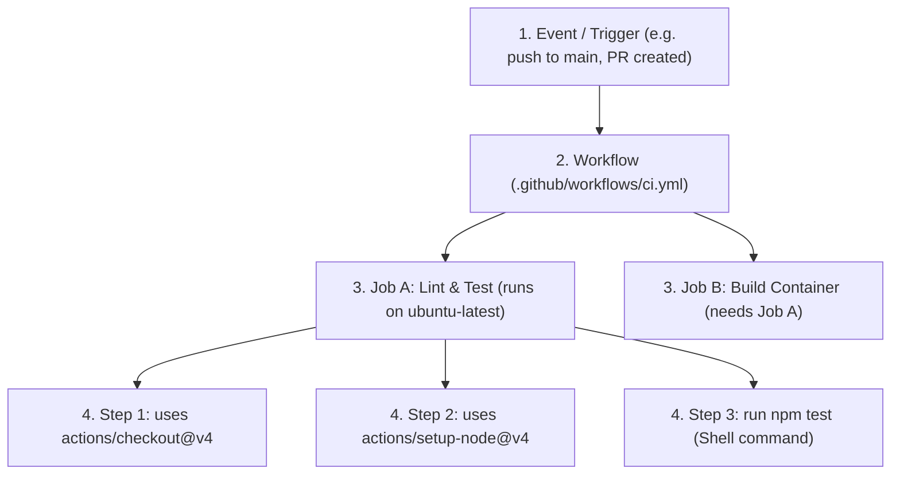

# CI/CD Introduction & GitHub Actions Overview

---

<strong>What is CI/CD and What Pain Points Does It Solve?</strong>

 

Before modern CI/CD, software development suffered from **"Integration Hell"**:
- Developers worked on isolated feature branches for weeks or months.
- Merging everything before a release took days of painful conflict resolution.
- Testing was done manually by QA teams right before release dates.
- Bugs discovered late delayed releases, and production deployments often happened late at night with everyone praying nothing crashed.

---

### The Three Pillars of Modern CI/CD

| Pillar | Definition | Key Activities | Human Gate? |
| :--- | :--- | :--- | :---: |
| **Continuous Integration (CI)** | Frequently merging code changes into the main branch (multiple times per day), verified by automated builds and tests. | Code checkout, dependency installation, linting, unit tests, security scans. | ❌ (100% Automated on Push/PR) |
| **Continuous Delivery (CD)** | Automatically preparing and packaging tested code so that it is **always in a releasable state** to production. | Docker image building, deployment to Staging/QA environments, end-to-end smoke tests. | ✅ **YES** (Requires a 1-click manual sign-off before Prod) |
| **Continuous Deployment (CD)** | Every single change that passes all automated tests and quality gates is deployed **directly to production**. | Automated blue/green or canary rollouts, traffic routing, automated rollback on error spikes. | ❌ (Zero Human Intervention) |

> [!NOTE]
> Most enterprise organizations practice **Continuous Delivery** (keeping code continuously deployable, but retaining a manual approval button for compliance or business scheduling), while hyper-agile tech companies practice **Continuous Deployment**.

---

<strong>Evolution: Legacy CI/CD (Jenkins) vs. Cloud-Native (GitHub Actions)</strong>

 

| Feature | Legacy CI/CD (e.g., Jenkins) | Modern Cloud-Native (GitHub Actions) |
| :--- | :--- | :--- |
| **Hosting &amp; Maintenance** | Self-hosted master-agent servers requiring dedicated maintenance, patching, and OS upgrades | **Fully Managed / Serverless**: GitHub provides ephemeral, clean VMs instantly on demand |
| **Configuration** | UI configuration or Groovy Jenkinsfile | **Declarative YAML** stored directly in the Git repository (`.github/workflows/`) |
| **Integration** | Requires complex webhooks, SSH keys, and GitHub personal access tokens | **Native First-Class Citizen**: Automatic access to PRs, issues, commits, comments, and releases |
| **Ecosystem &amp; Plugins** | Java plugin architecture (notorious for "plugin dependency hell" and breaking upgrades) | **GitHub Marketplace**: Composable, version-pinned actions (`uses: actions/checkout@v4`) |
| **Runner Isolation** | Shared worker nodes (files from previous builds can pollute the environment) | **Fresh Ephemeral VMs**: Every job gets a pristine, isolated virtual machine destroyed upon completion |

---

<strong>GitHub Actions Architecture: The Core Building Blocks</strong>

 

GitHub Actions follows a hierarchical structure:

### 1. Workflows (`.github/workflows/*.yml`)
- Automated procedures configured in YAML files located inside `.github/workflows/` in the root of your repository.
- A repository can have multiple workflows (e.g., `ci.yml`, `release.yml`, `security-scan.yml`, `nightly-cron.yml`).

### 2. Events (`on:`)
- The trigger that causes GitHub to run the workflow.
- Can be Git events (`push`, `pull_request`), scheduled cron jobs (`schedule:`), or manual UI triggers (`workflow_dispatch`).

### 3. Jobs (`jobs:`)
- A collection of steps that execute on the **same runner instance**.
- **Important Rule**: By default, jobs inside a workflow run in **parallel**.
- To make a job wait for another, define dependencies with `needs: [job_name]`.

### 4. Runners (`runs-on:`)
- The virtual machine or container executing your job.
- **GitHub-hosted runners**: Managed by GitHub with pre-installed tools (Ubuntu, Windows Server, macOS).
- **Self-hosted runners**: Your own on-premise servers, AWS EC2 instances, or Kubernetes pods registered with GitHub.

### 5. Steps (`steps:`)
- Individual executable tasks within a job. Steps execute sequentially in order.
- A step can either:
  - Run a shell command (`run: pytest`)
  - Execute a pre-built reusable Action (`uses: actions/setup-python@v5`)

### 6. Actions (`uses:`)
- Smallest portable building block of a workflow.
- Created by GitHub (`actions/checkout`), third parties (`docker/build-push-action`), or authored custom inside your repo.

---

<strong>Understanding GitHub Actions Pricing &amp; Compute Limits</strong>

 

- **Public Repositories**:
  - GitHub Actions is **100% free with unlimited minutes** for public open-source repositories!
- **Private Repositories**:
  - GitHub Free accounts receive **2,000 free minutes/month**.
  - GitHub Pro accounts receive **3,000 minutes/month**.
  - GitHub Team accounts receive **10,000 minutes/month**.
- **Execution Limits**:
  - Maximum job run time: **6 hours**.
  - Maximum workflow run time: **35 days**.
  - Job matrix maximum: **256 jobs per run**.

---

<strong>Summary Checklist: CI/CD &amp; GitHub Actions Overview</strong>

 

- [x] **Continuous Integration**: Merge code often, automatically build, lint, and test on every commit/PR.
- [x] **Continuous Delivery vs Deployment**: Delivery keeps code deployable with a manual gate; Deployment is 100% automated straight to prod.
- [x] **YAML Location**: All workflows must live in `.github/workflows/*.yml`.
- [x] **Execution Model**: Events trigger Workflows &rarr; Workflows spawn Jobs &rarr; Jobs run on Runners &rarr; Runners execute sequential Steps &rarr; Steps run Actions or shell commands.
- [x] **Parallel by Default**: Independent jobs run simultaneously unless explicitly serialized using `needs:`.

