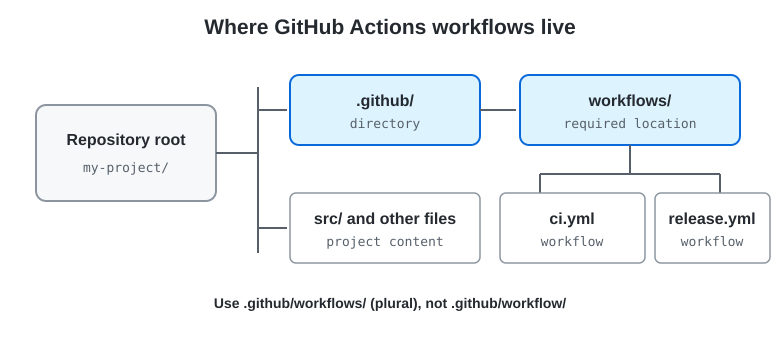

# The `.github/workflows/` Directory

---

<details>
<summary><strong>Required location</strong></summary>

<br>



GitHub Actions workflow definitions belong in the repository's **`.github/workflows/`** directory. The directory name is plural: `.github/workflows`, not `.github/workflow`.

Each workflow is a YAML file in that directory. A repository can contain multiple workflow files, and GitHub evaluates them independently for events that match their triggers.

</details>

---

<details>
<summary><strong>Example repository layout</strong></summary>

<br>

```text
my-project/
├── .github/
│   └── workflows/
│       ├── ci.yml
│       ├── release.yml
│       └── scheduled-checks.yaml
├── src/
├── tests/
└── README.md
```

Both `.yml` and `.yaml` are commonly used extensions for workflow files. Keeping names descriptive makes it easier to understand their purpose in the Actions interface.

</details>

---

<details>
<summary><strong>Minimal workflow file</strong></summary>

<br>

```yaml
name: Basic CI

on:
  push:
    branches: [main]
  pull_request:
    branches: [main]

jobs:
  check:
    runs-on: ubuntu-latest
    steps:
      - name: Check out repository
        uses: actions/checkout@v4
      - name: Report the revision
        run: echo "Checking $GITHUB_SHA"
```

The workflow defines a name, event triggers, a job, its runner, and ordered steps. Replace the example command with checks appropriate to the project.

</details>

---

<details>
<summary><strong>How to add and verify a workflow</strong></summary>

<br>

1. Create `.github/workflows/` at the repository root if it does not exist.
2. Add a YAML file with a descriptive name, such as `ci.yml`.
3. Define an event under `on:` and at least one job under `jobs:`.
4. Commit and push the file to GitHub.
5. Generate a matching event, or use `workflow_dispatch` if the workflow is configured for manual runs.
6. Open the repository's **Actions** tab to inspect the run, job logs, and result.

YAML indentation is significant. Validate the structure and expressions before relying on a workflow to protect merges or publish releases.

</details>

---

<details>
<summary><strong>Organization and safety tips</strong></summary>

<br>

- Keep workflow files focused; split unrelated automation into separate workflows when that improves clarity.
- Use branch and path filters when only particular changes should trigger expensive jobs.
- Grant the workflow only the `GITHUB_TOKEN` permissions it needs.
- Store credentials in GitHub secrets or an appropriate external secret manager; do not commit them in workflow YAML.
- Treat actions from outside the repository as dependencies: review their source and pin trusted versions according to your policy.
- Consider the trust level of the triggering code before using secrets or self-hosted runners, especially for pull requests from forks.

</details>

---

<details>
<summary><strong>Summary checklist</strong></summary>

<br>

- [x] The required directory is `.github/workflows/` (plural).
- [x] Each YAML file in that directory defines a workflow.
- [x] Workflow files can be reviewed and versioned with the source code.
- [x] Matching events start runs that can be inspected in the Actions tab.
- [x] Permissions, secrets, and runner choice should be limited to what the workflow requires.

</details>
