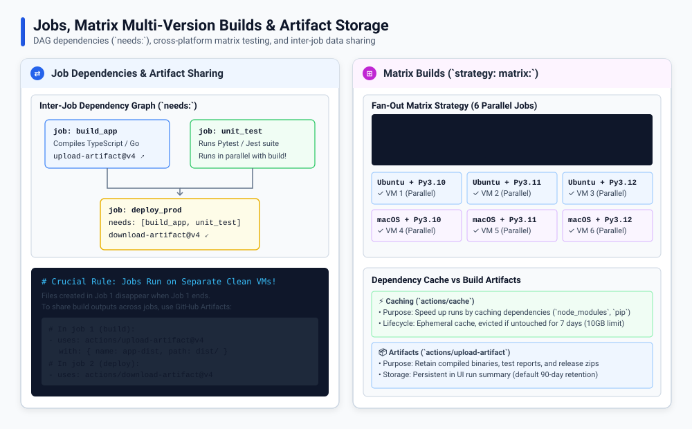

# GitHub Actions: Jobs, Steps, Matrix, and Artifacts

This guide covers four common workflow building blocks: jobs, steps, matrix jobs, and artifacts.



---

## Jobs and steps

A **job** is a set of tasks that runs on one runner. A job contains one or more **steps**, and steps run in order.

- Use `run` to execute a shell command.
- Use `uses` to call a reusable action.

```yaml
jobs:
  test:
    runs-on: ubuntu-latest
    steps:
      - name: Check out the code
        uses: actions/checkout@v4
      - name: Run tests
        run: echo "Run the project's tests here"
```

By default, separate jobs can run in parallel. Each job has its own runner, so files from one job are not automatically available in another.

## Job dependencies with `needs`

Use `needs` when a job must wait for another job to finish successfully:

```yaml
jobs:
  test:
    runs-on: ubuntu-latest
    steps:
      - run: echo "Run tests"

  build:
    needs: test
    runs-on: ubuntu-latest
    steps:
      - run: echo "Build after tests pass"
```

Here, `build` starts only after `test` succeeds.

## Matrix jobs

A **matrix** runs the same job with different values. This is useful for checking multiple runtime versions or operating systems without copying the job:

```yaml
jobs:
  test:
    runs-on: ubuntu-latest
    strategy:
      matrix:
        node-version: [20, 22]
    steps:
      - uses: actions/checkout@v4
      - name: Show selected version
        run: echo "Testing Node.js ${{ matrix.node-version }}"
```

This creates two jobs, one for each Node.js version. Add another matrix field, such as an operating system, to test more combinations.

## Passing files between jobs with artifacts

An **artifact** stores files produced during a workflow run. Use it when a later job needs files made by an earlier job.

```yaml
jobs:
  build:
    runs-on: ubuntu-latest
    steps:
      - run: mkdir -p output && echo "Build result" > output/result.txt
      - uses: actions/upload-artifact@v4
        with:
          name: build-output
          path: output/

  use-build:
    needs: build
    runs-on: ubuntu-latest
    steps:
      - uses: actions/download-artifact@v4
        with:
          name: build-output
      - run: cat output/result.txt
```

Artifacts can also be downloaded from the workflow run page. They are for saving or sharing files, not for speeding up dependency installation.

## Caching versus artifacts

| Use | Purpose | Example |
| :--- | :--- | :--- |
| **Cache** | Reuse downloaded dependencies to make later runs faster. | Package-manager download cache |
| **Artifact** | Save files generated by a run or pass them to another job. | Build output or test report |

Use the cache action or a setup action's built-in caching option when you want to speed up dependency installation. Use artifacts when you need to retain or transfer generated files.

## Summary

- **Job:** a group of steps running on a runner.
- **Step:** a shell command (`run`) or reusable action (`uses`).
- **`needs`:** makes a job wait for another job.
- **Matrix:** repeats a job with different input values.
- **Artifact:** saves or transfers files produced by a workflow run.
- **Cache:** reuses data, usually dependencies, to speed up later runs.
