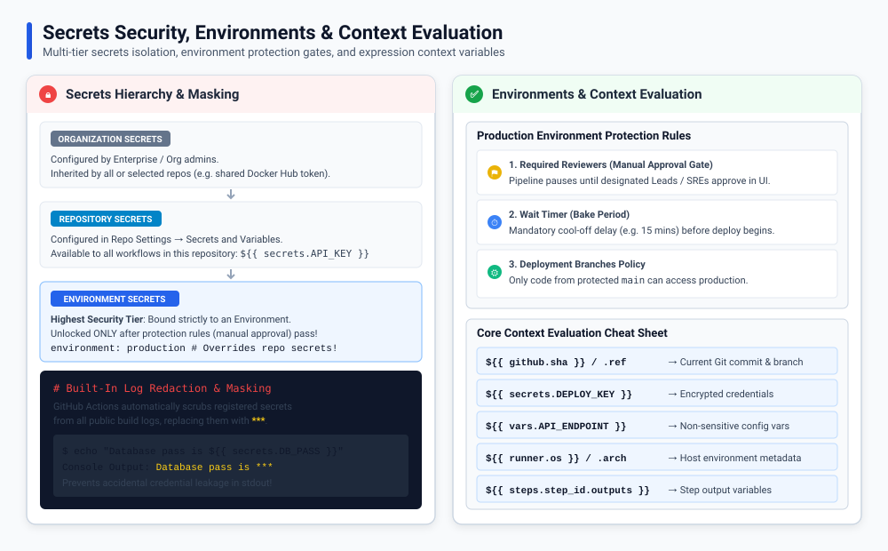

# GitHub Actions: Secrets, Environments, and Contexts

Use **secrets** for sensitive values, **variables** for non-sensitive configuration, and **environments** to organize and protect deployments.



## Secrets

Secrets store sensitive values such as deployment tokens and passwords. Add them in your repository settings under **Settings → Secrets and variables → Actions**. Secrets can also be managed at organization or environment scope.

Pass a secret to a step using the `secrets` context:

```yaml
jobs:
  deploy:
    runs-on: ubuntu-latest
    steps:
      - name: Deploy
        env:
          DEPLOY_TOKEN: ${{ secrets.DEPLOY_TOKEN }}
        run: ./deploy.sh
```

Do not commit secrets to the repository or print them in logs. GitHub masks registered secret values in logs, but masking is not a substitute for keeping them private. Secrets are generally unavailable to workflows triggered by pull requests from forks.

Every workflow run can use the built-in `${{ secrets.GITHUB_TOKEN }}`. Limit its access with `permissions:`:

```yaml
permissions:
  contents: read
```

## Configuration variables

Use configuration variables for non-sensitive settings such as a deployment region or service URL. Define them in GitHub settings under **Settings → Secrets and variables → Actions → Variables**, then access them with `vars`:

```yaml
jobs:
  deploy:
    runs-on: ubuntu-latest
    steps:
      - name: Show deployment region
        env:
          REGION: ${{ vars.DEPLOY_REGION }}
        run: echo "Deploying to $REGION"
```

Use `vars` for configuration, not passwords or tokens.

## Environments

An environment represents a deployment target, such as `staging` or `production`. A job can declare which environment it uses:

```yaml
jobs:
  deploy:
    runs-on: ubuntu-latest
    environment: production
    steps:
      - run: ./deploy.sh
```

In repository settings, environments can have their own secrets and variables, deployment branch rules, wait timers, and required reviewers. If approval is required, the job waits for an authorized reviewer before it proceeds.

## Contexts

Contexts provide values about the workflow run. They use the `${{ context.property }}` syntax:

| Context | Provides | Example |
| :--- | :--- | :--- |
| `github` | Repository and event information | `${{ github.repository }}`, `${{ github.ref_name }}` |
| `vars` | Configuration variables | `${{ vars.DEPLOY_REGION }}` |
| `secrets` | Secrets and `GITHUB_TOKEN` | `${{ secrets.DEPLOY_TOKEN }}` |
| `env` | Values set using workflow, job, or step `env:` | `${{ env.LOG_LEVEL }}` |
| `runner` | Runner information | `${{ runner.os }}` |
| `steps` | Outputs and results from earlier steps in the same job | `${{ steps.build.outputs.version }}` |
| `needs` | Results and outputs from dependent jobs | `${{ needs.build.outputs.version }}` |

For example, `github.ref_name` gives the branch or tag name, while `github.event_name` identifies the triggering event. Context availability depends on where it is used; see GitHub's [Contexts reference](https://docs.github.com/actions/learn-github-actions/contexts).

## Remember

- Keep secrets out of source code and logs.
- Use `vars` for non-sensitive settings and `secrets` for credentials.
- Use an environment to apply deployment-specific settings or approval rules.
- Limit `GITHUB_TOKEN` permissions to what the workflow needs.
