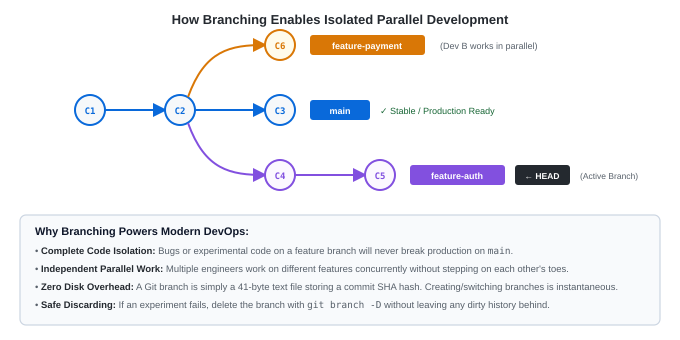

# Git Branching Concepts

---

<details>
<summary><strong>What is a Branch in Git?</strong></summary>

<br>

- **A Lightweight Movable Pointer**: Under the hood, a Git branch is not a copy of all your files. It is simply a tiny text file (41 bytes) containing the 40-character SHA-1 hash of the commit it points to.
  ```text
  .git/refs/heads/main  --> contains commit hash: "a1b2c3d4e5..."
  ```
- **Zero Cost & Instantaneous**: Unlike older centralized systems (like SVN) that copied the entire directory tree onto the server to make a branch, creating a branch in Git takes milliseconds and consumes almost zero disk space.
- **The Default Branch**: When a repository is initialized with `git init`, Git creates a primary branch, by default named **`main`** (historically `master`).

</details>

---

<details>
<summary><strong>How Does Branching Help Software &amp; DevOps Development?</strong></summary>

<br>



1. **Production Code Isolation**:
   - The primary branch (`main`) represents clean, production-ready, deployable code at all times.
   - All experimental, in-progress, or unfinished work stays completely isolated on feature branches.

2. **Parallel Teamwork Without Conflicts**:
   - Developer A works on `feature-auth` while Developer B works on `feature-payment`.
   - Neither developer interferes with or sees each other's half-baked code until it is ready for code review.

3. **Emergency Production Hotfixes**:
   - If a critical bug breaks in production while you are in the middle of a 2-week feature, you don't have to scramble or stash dirty code.
   - You simply branch off `main` as `hotfix-login`, fix the bug, release it to production, and then return seamlessly to your feature branch.

4. **Risk-Free Experimentation**:
   - Want to test a new database driver or upgrade a major framework version? Create a branch `experiment-db-upgrade`.
   - If it works, merge it. If it fails, simply delete the branch without leaving any dirty history in your main project.

</details>

---

<details>
<summary><strong>What is <code>HEAD</code> in Git and How Does It Work?</strong></summary>

<br>

- **The "You Are Here" Marker**: `HEAD` is Git's internal pointer that points to the **currently active branch** (and thus the current commit snapshot) checked out in your working directory.
- **How `HEAD` navigates**:
  ```text
  HEAD  ----points to---->  refs/heads/feature-auth  ----points to---->  Commit C5
  ```
  When you run `git switch main`, Git simply updates `HEAD` to point to `refs/heads/main`, and replaces the files in your workspace to match `main`'s snapshot.

- **Detached HEAD State**:
  - Happens if you checkout a specific commit hash directly (e.g. `git checkout a1b2c3d`) instead of a branch name.
  - In a detached HEAD state, `HEAD` points directly to a commit, not a branch. Any new commits made here are "floating" and will be lost if you switch branches without creating a new branch pointer first.

</details>

---

<details>
<summary><strong>Branch Naming Conventions in Real-World DevOps</strong></summary>

<br>

In professional teams, branches follow standardized prefixes to describe their purpose:

| Prefix | Example | Purpose |
|---|---|---|
| **`feature/`** or **`feat/`** | `feat/oauth-login` | Adding new functionality |
| **`bugfix/`** or **`fix/`** | `fix/null-pointer-exception` | Resolving an existing bug |
| **`hotfix/`** | `hotfix/security-patch-v1.2` | Emergency fix directly for production |
| **`chore/`** | `chore/upgrade-deps` | Maintenance, dependencies, or tool configs |
| **`release/`** | `release/v2.1.0` | Preparing a new production release candidate |

</details>
