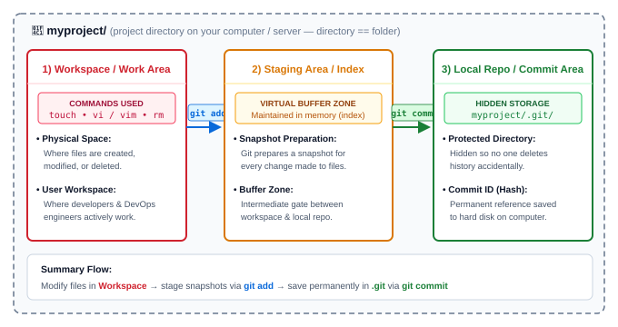

# Git Local Architecture

---

<strong>What is Git Local (Directory vs. Folder)?</strong>

 

- In Linux and Git terminology: **`directory == folder`**
- **`myproject/`**: It is a project directory on your computer/server where Git operates locally.

---

<strong>What are the Three Main Areas of Git Local?</strong>

 

| Area | Nature | Commands Used | Key Purpose |
|---|---|---|---|
| **1) Workspace / Work Area** | Physical files on disk | `touch`, `vi`, `rm` | Create, modify, delete project files |
| **2) Staging Area / Indexing Area** | Virtual area in memory | `git add` | Buffer zone; takes snapshot of changes |
| **3) Local Repository / Commit Area** | Saved in hidden `.git/` folder | `git commit` | Permanent commit history saved to hard disk |

---

<strong>1) Workspace / Work Area — What is it and how do we use it?</strong>

 

- **Physical workspace**: It is the place on your filesystem where we create, modify, or delete files physically.
- **Commands used**:
  - `touch` — create new empty files
  - `vi` / `vim` / editor — edit and modify file content
  - `rm` / delete — remove files
- **Who works here**: As a developer or DevOps engineer, you spend most of your active time working in this workspace.

---

<strong>2) Staging Area / Indexing Area — What is it and why is it needed?</strong>

 

- **Snapshot creation**: In this area, Git takes a snapshot for every version or changes made to a file.
- **Buffer zone**: It acts as an intermediate buffer zone between your physical workspace and the local repository.
- **Virtual area**: We cannot see this region directly in file explorer as it is a virtual area maintained in memory (`.git/index`).
- **Command used**:
  - `git add <filename>` — stages changes to be included in the next commit snapshot.

---

<strong>3) Local Repository / Commit Area — Where and how are commits stored?</strong>

 

- **Hidden `.git` directory**: It is the place where Git stores all commits locally in the hidden `.git/` directory inside your `myproject/` directory.
- **Accidental deletion protection**: `.git` is hidden by default so that nobody deletes the version history accidentally.
- **Commit ID**: A unique reference (SHA-1 hash) representing the changes made to a single or multiple files, permanently saved to the hard disk on your computer.
- **Command used**:
  - `git commit -m "<message>"` — commits all staged changes into the local repository.

---

<strong>How do files transition across the three areas?</strong>

 

$$\text{Workspace} \xrightarrow{\text{git add}} \text{Staging Area} \xrightarrow{\text{git commit}} \text{Local Repository (.git)}$$

1. You create or modify files in your **Workspace** using physical commands (`touch`, `vi`, `rm`).
2. You run **`git add`** to snapshot and stage specific changes in the **Staging Area**.
3. You run **`git commit`** to permanently record the staged snapshot into the **Local Repository** with a commit ID.

