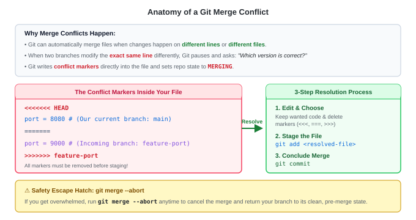

# Git Merge Conflicts — Architecture & Concepts

---

<details>
<summary><strong>What is a Merge Conflict and Why Does It Happen?</strong></summary>

<br>

- **Automatic Merge Success**: Git is very smart at merging automatically. If Developer A changes line 10 of `app.py`, and Developer B changes line 50 of `app.py` (or a completely different file `utils.py`), Git merges them together seamlessly with zero intervention.
- **When Conflicts Occur**: A merge conflict happens when **two branches modified the exact same lines of the same file**, or one branch deleted a file that another branch modified.
- **Why Git Stops**: Because Git cannot guess your business logic or human intent. Rather than corrupting your codebase by guessing, Git safely pauses the merge, modifies the file with **conflict markers**, and hands decision-making back to you.

</details>

---

<details>
<summary><strong>What are Conflict Markers? (How to Read Them)</strong></summary>

<br>

When a conflict occurs, Git writes three special marker lines directly into the conflicting file:

```text
<<<<<<< HEAD
ServerPort = 8080    # Your change (current checked-out branch: main)
=======
ServerPort = 9000    # Incoming change (branch being merged: feature-port)
>>>>>>> feature-port
```

| Marker | What It Means |
|---|---|
| **`<<<<<<< HEAD`** | Beginning of the conflicting section. Shows the version on your current target branch (`main`). |
| **`=======`** | The center separator dividing the two conflicting versions. |
| **`>>>>>>> <branch>`** | End of the conflict. Shows the version from the incoming branch being merged. |

> [!IMPORTANT]
> All marker lines (`<<<<<<<`, `=======`, `>>>>>>>`) **must be deleted** during resolution before you commit. Leaving them behind will result in syntax errors in your application code.

</details>

---

<details>
<summary><strong>Visualizing the Conflict &amp; Resolution Lifecycle</strong></summary>

<br>



1. **Git Pauses Merge**: Leaves conflicting files in an unmerged state (`both modified`).
2. **Manual Decision**: You open the file and choose:
   - Keep current branch version (`HEAD`)
   - Keep incoming version (`feature`)
   - Combine both versions into a new hybrid solution
3. **Stage the File**: Run `git add <file>` to tell Git the conflict is resolved.
4. **Finalize Merge**: Run `git commit` to seal the merge snapshot.

</details>

---

<details>
<summary><strong>The Emergency Safety Net: <code>git merge --abort</code></strong></summary>

<br>

- If you encounter a complex conflict and are not ready to resolve it, or if you accidentally merged the wrong branch, you can abort cleanly:
  ```bash
  git merge --abort
  ```
- **What it does**: Completely rolls back the merge attempt and restores your branch to the exact state it was in before you ran `git merge`. No files are corrupted or lost.

</details>

---

<details>
<summary><strong>DevOps Best Practices to Prevent &amp; Minimize Merge Conflicts</strong></summary>

<br>

1. **Keep Branches Short-Lived**: Do not let a feature branch sit open for weeks. Merge small, incremental changes frequently.
2. **Rebase or Merge `main` into Feature Regularly**: Keep your feature branch updated with `main` daily so conflicts are small and resolved immediately.
3. **Coordinate Shared Files**: Avoid multiple developers refactoring the same core configuration files (e.g. `docker-compose.yml`, `settings.py`) in parallel without team alignment.
4. **Leverage Modern Editor Merge Tools**: VS Code, IntelliJ, and GitHub PR reviews provide clickable UI buttons (*"Accept Current"*, *"Accept Incoming"*, *"Accept Both"*) to speed up conflict resolution.

</details>

