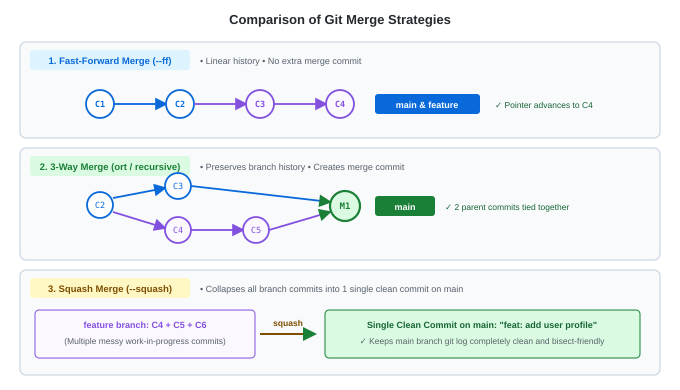

# Git Merge Strategies — Concepts & Architecture

---

<details>
<summary><strong>What is a Git Merge and How Does It Work?</strong></summary>

<br>

- **Combining Histories**: A merge brings the commit history and changes from a **source branch** into your **target (currently active) branch**.
- **The Golden Rule**:
  $$\text{1. Switch to receiver branch:} \quad \mathbf{\texttt{git switch <target>}}$$
  $$\text{2. Pull in incoming branch:} \quad \mathbf{\texttt{git merge <feature>}}$$
- Depending on the relationship between the branches, Git selects or allows you to specify a **merge strategy**.

</details>

---

<details>
<summary><strong>Strategy 1: Fast-Forward Merge (<code>--ff</code>)</strong></summary>

<br>

- **When It Happens**: When the target branch (`main`) has **no new commits** since the feature branch diverged from it.
- **How Git Handles It**: History is strictly linear. Git does not create a new merge commit. It simply slides the `main` pointer forward to point to the latest commit on the feature branch.
- **The `--no-ff` (No Fast-Forward) Flag**:
  - By running `git merge --no-ff feature`, you force Git to create a dedicated merge commit even if a fast-forward was possible.
  - Useful when a team wants explicit historical documentation of when a feature was merged.

</details>

---

<details>
<summary><strong>Strategy 2: 3-Way Merge (<code>ort</code> / Recursive Strategy)</strong></summary>

<br>

- **When It Happens**: When both branches have **diverged** (i.e. `main` has new commits, AND the feature branch has new commits).
- **Why It's Called "3-Way"**: Git analyzes **3 snapshots** to compute the merge:
  1. The **Common Ancestor** commit (where the branches first split).
  2. The tip of the **Target branch** (`HEAD` / `main`).
  3. The tip of the **Incoming branch** (`feature`).
- **Result**: Git combines changes and creates a brand-new **Merge Commit** with **two parent commits**, preserving the full historical graph.

</details>

---

<details>
<summary><strong>Strategy 3: Squash Merge (<code>--squash</code>)</strong></summary>

<br>

- **The Problem It Solves**: Developers often make dozens of small, messy commits while developing a feature (`"fix typo"`, `"wip"`, `"test fix"`, `"really fix now"`). Merging all these commits directly pollutes the production `main` log.
- **How It Works**:
  ```bash
  git merge --squash feature-branch
  git commit -m "feat: complete user authentication module"
  ```
  - Takes all changes from the feature branch, combines them into a single staged changeset, and creates **one clean, atomic commit** on `main`.
- **Ideal For**: GitHub/GitLab Pull Requests where you want a clean, bisect-friendly commit history on `main`.

</details>

---

<details>
<summary><strong>Visualizing &amp; Comparing All 3 Strategies</strong></summary>

<br>



| Merge Strategy | New Commit Created? | Keeps Feature History? | Best Used For |
|---|---|---|---|
| **Fast-Forward (`--ff`)** | ❌ No (pointer moves) | ✅ Yes (linear) | Short-lived local branches |
| **3-Way Merge (`ort`)** | ✅ Yes (Merge Commit) | ✅ Yes (full graph) | Merging major releases / long-lived branches |
| **Squash Merge (`--squash`)** | ✅ Yes (Single Commit) | ❌ No (collapses N into 1) | PRs with messy work-in-progress commits |

</details>

---

<details>
<summary><strong>Git Merge vs. Git Rebase (Quick Mental Model)</strong></summary>

<br>

- **`git merge`**: Non-destructive. Preserves the exact chronological reality of how and when commits were made. The graph shows branches splitting and joining.
- **`git rebase`**: History rewriter. Takes your feature commits and replays them one-by-one on top of the latest `main` commit, producing a single straight line of history without merge commits.

$$\text{Merge} = \text{Preserve True History} \qquad \text{Rebase} = \text{Clean Linear Storytelling}$$

</details>

