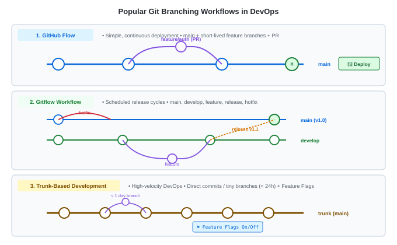

# Git Branching Workflows — Concepts & Comparison

---

<details>
<summary><strong>What is a Git Workflow and Why Does Your Team Need One?</strong></summary>

<br>

- **A Team Protocol**: Git itself gives you unlimited freedom to create and merge branches however you want. A **Git Workflow** is an agreed-upon set of rules and conventions that defines:
  - How branches are named (`feature/`, `bugfix/`, `release/`).
  - Which branch represents production code.
  - When and how code reviews (Pull Requests / Merge Requests) occur.
  - How CI/CD pipelines trigger deployments.
- **Without a Workflow**: Teams quickly suffer from "merge hell", uncoordinated releases, broken production builds, and untracked hotfixes.

</details>

---

<details>
<summary><strong>Workflow 1: GitHub Flow (The Modern Cloud &amp; Web Standard)</strong></summary>

<br>

GitHub Flow is a lightweight, branch-based workflow optimized for teams that deploy regularly (Continuous Delivery).

### The 6 Core Steps:
1. **`main` is Always Deployable**: Anything in `main` is tested and production-ready.
2. **Branch from `main`**: Create descriptively named branches (e.g. `feature/user-profile`).
3. **Commit &amp; Push Regularly**: Push your branch to the remote server to backup work.
4. **Open a Pull Request (PR)**: Solicit code review, discuss implementation, and trigger automated CI tests.
5. **Review &amp; Approve**: Team members review diffs and automated quality gates pass.
6. **Merge &amp; Deploy Immediately**: Merge into `main` and deploy directly to production.

- **Best For**: Web applications, microservices, SaaS products with continuous deployment.

</details>

---

<details>
<summary><strong>Workflow 2: Gitflow Workflow (Traditional &amp; Scheduled Releases)</strong></summary>

<br>

Created by Vincent Driessen in 2010, Gitflow is a strict, structured workflow built around release cycles.

### The 5 Types of Branches:
1. **`main`**: Stores official production releases. Only tagged release commits and critical hotfixes go here.
2. **`develop`**: The integration branch where features gather. Serves as the base for all new work.
3. **`feature/*`**: Branches off `develop` and merges back into `develop`.
4. **`release/*`**: Branches off `develop` when features for a version are frozen. Only bugfixes, documentation, and polish happen here before merging into both `main` AND `develop`.
5. **`hotfix/*`**: Branches directly off `main` to address critical emergency production bugs, then merges into both `main` AND `develop`.

- **Best For**: Traditional software with versioned release cadences (e.g. mobile apps, enterprise software shipped quarterly, embedded systems).
- **Cons for DevOps**: Very complex, creates long-lived branches, and slows down high-frequency CI/CD.

</details>

---

<details>
<summary><strong>Workflow 3: Trunk-Based Development (The DevOps Elite Choice)</strong></summary>

<br>

Trunk-Based Development (TBD) is the gold standard favored by high-performing DevOps teams (Google, Netflix, Amazon) to enable true **Continuous Integration**.

### Core Principles:
1. **One Central Trunk (`main`)**: All developers commit to a single trunk branch.
2. **Short-Lived Branches**: If branches are used, they live for **less than 24 hours** and contain small, atomic changes (often only a few dozen lines).
3. **Feature Flags (Toggles)**:
   - How do you deploy incomplete features without breaking production?
   - Incomplete code is wrapped inside a conditional feature flag:
     ```python
     if feature_flags.is_enabled("NEW_PAYMENT_GATEWAY", user):
         run_new_stripe_engine()
     else:
         run_legacy_payment_engine()
     ```
   - Code is merged to `main` continuously, but the feature remains hidden until production-ready.

- **Best For**: Mature DevOps teams with robust automated testing (CI) and automated deployments (CD).

</details>

---

<details>
<summary><strong>Workflow 4: GitLab Flow (Environment &amp; Release Branches)</strong></summary>

<br>

GitLab Flow bridges the gap between Gitflow and GitHub Flow by aligning branches directly with infrastructure environments.

### Environment Branches:
```text
feature-branch ──(PR)──> main ──(deploy)──> Staging ──(deploy)──> Production
```
- **`main`**: Reflects the current state of code ready for testing.
- **`staging`**: Deploys automatically to the QA/Staging environment.
- **`production`**: Commits merged here trigger automated production deployment.

- **Best For**: Organizations where code must pass through distinct physical deployment stages (Dev &rarr; Staging &rarr; Prod) before release.

</details>

---

<details>
<summary><strong>Visual Comparison of All 3 Major Workflows</strong></summary>

<br>



| Feature | GitHub Flow | Gitflow | Trunk-Based Development |
|---|---|---|---|
| **Branch Complexity** | Low (main + feature) | High (5 branch types) | Minimal (trunk + tiny branches) |
| **Branch Lifespan** | A few days | Weeks to months | &lt; 24 hours |
| **Deployment Model** | Continuous Delivery | Scheduled releases | Continuous Deployment |
| **Merge Conflict Risk** | Moderate | High (due to long branches) | Very Low (frequent integration) |
| **Required Testing Automation** | Moderate | Low (manual QA supported) | High (automated test suite mandatory) |
| **Industry Adoption** | Web & SaaS standard | Legacy / Mobile apps | Modern High-Velocity DevOps |

</details>

---

<details>
<summary><strong>How to Choose the Right Workflow for Your Team?</strong></summary>

<br>

- Choose **GitHub Flow** if: You are building web apps, APIs, or microservices with automated testing and want a fast, simple PR review cycle.
- Choose **Gitflow** if: You maintain multiple release versions in production simultaneously (e.g. v1.2, v1.3, v2.0) or have strict external compliance approval gates.
- Choose **Trunk-Based Development** if: You have high automated test coverage, deploy to production multiple times a day, and want to eliminate merge conflicts entirely.

</details>

