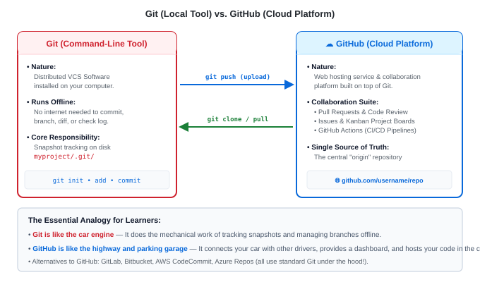

# GitHub Overview — Concepts & Architecture

---

<strong>What is GitHub? (And How Does It Differ from Git?)</strong>

 

One of the most common confusions for beginners is mixing up **Git** and **GitHub**:

| Dimension | Git (The Engine) | GitHub (The Cloud Platform) |
|---|---|---|
| **What is it?** | A command-line software tool | A web-based cloud hosting service |
| **Where does it run?** | Locally on your computer | On Microsoft/GitHub cloud servers |
| **Requires Internet?** | ❌ No. 100% functional offline | ✅ Yes. Web access required to sync |
| **Created by** | Linus Torvalds (2005) | Chris Wanstrath, PJ Hyett, Tom Preston-Werner (2008) |
| **Key Features** | `git init`, `add`, `commit`, `branch`, `diff` | Pull Requests, Issues, Actions (CI/CD), Releases |
| **Alternatives** | Mercurial, SVN | GitLab, Bitbucket, Azure Repos, AWS CodeCommit |

> [!TIP]
> **The Mental Analogy**: **Git is like a car engine** (it does the mechanical work of snapshotting files offline). **GitHub is like the highway network and parking garage** (it connects cars together, provides social infrastructure, and hosts your vehicle in the cloud).

---

<strong>How Should You Look at GitHub? (The DevOps Mental Model)</strong>

 

In modern DevOps, GitHub is far more than just a place to store files. It is the **command center of the software development lifecycle (SDLC)**:

1. **The Single Source of Truth (`origin`)**:
   - Every developer has their own local copy of the repository. GitHub hosts the canonical upstream copy that production environments pull from.

2. **The Code Review &amp; Quality Gatekeeper**:
   - Engineers do not push directly into production. Instead, they open a **Pull Request (PR)** on GitHub where teammates review line-by-line diffs, leave comments, and suggest improvements.

3. **The CI/CD Automation Engine (GitHub Actions)**:
   - When code is pushed or a PR is opened, GitHub automatically runs unit tests, security scans, Docker image builds, and automated deployments to Kubernetes or cloud providers.

4. **Project Management &amp; Issue Tracking**:
   - Built-in issue trackers, Kanban project boards, milestones, and discussions eliminate the need for disjointed external tools for basic task tracking.

5. **Security &amp; Compliance Hub**:
   - Automatic scanning for accidentally committed passwords/tokens (**Secret Scanning**).
   - Automated dependency vulnerability alerts and update PRs (**Dependabot**).

---

<strong>Anatomy of a GitHub Repository (Touring the Web Interface)</strong>

 

When you open any repository on GitHub (`github.com/username/repo`), you will see these essential tabs:

| Tab | What It Does | Why DevOps Engineers Care |
|---|---|---|
| **Code** | Browse files, commit history, and active branches | Clone URL (SSH/HTTPS), view commit hashes, download releases |
| **Issues** | Track bugs, tasks, and feature requests | Triage system outages, link commits to issue numbers (`#12`) |
| **Pull Requests** | Review and merge incoming code changes | Enforce peer review approvals and branch protection rules |
| **Actions** | Automated CI/CD pipeline runs | Inspect build logs, check test failures, monitor production deployments |
| **Security** | Vulnerability alerts and code scanning | Review exposed secrets, check third-party dependency vulnerabilities |
| **Insights** | Visual graphs of contributor activity and commit traffic | Analyze deployment frequency and team velocity |
| **Settings** | Configuration panel for repository owners | Manage collaborator access, configure webhooks, protect `main` branch |

---

<strong>Public vs. Private Repositories &amp; GitHub Organizations</strong>

 

### 1. Repository Visibility:
- **Public Repositories**:
  - Anyone on the internet can view, clone, and fork the code.
  - Ideal for open-source projects, public documentation, and developer portfolios.
- **Private Repositories**:
  - Only you and explicitly invited team members can access the code.
  - Used for proprietary commercial code, internal company infrastructure, and confidential configurations.

### 2. User Accounts vs. GitHub Organizations:
- **Personal Account** (`github.com/username`):
  - Owned by a single person. Good for personal learning and hobby projects.
- **Organization Account** (`github.com/company-name`):
  - Designed for enterprise teams.
  - Provides centralized billing, Role-Based Access Control (RBAC), team groupings (e.g. `@devops-team`, `@backend-team`), and organization-wide security policies.

---

<strong>How Local Git Authenticates with GitHub (SSH vs. HTTPS)</strong>

 

To prove you have permission to push code to a repository, GitHub offers two protocols:

1. **SSH (Recommended for Developers)**:
   - Uses public/private cryptographic key pairs (`id_ed25519`).
   - URL format: `git@github.com:username/repository.git`
   - **Advantage**: Zero password prompts once configured. Highest security.

2. **HTTPS**:
   - URL format: `https://github.com/username/repository.git`
   - Requires a **Personal Access Token (PAT)** or Git Credential Manager (passwords are rejected for Git operations).
   - **Advantage**: Works inside restrictive corporate firewalls where SSH port 22 is blocked.

