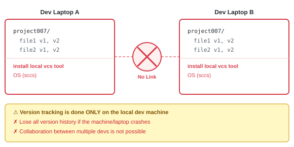
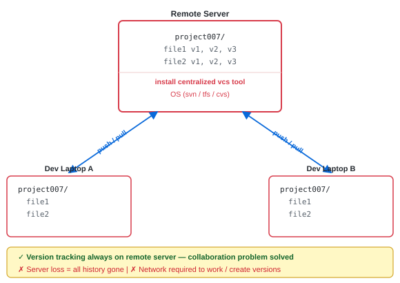
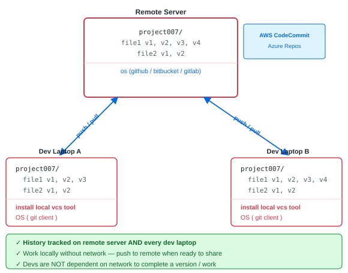

# Version Control System (VCS) — Introduction

---

<strong>What is a Version?</strong>

 

- Is a number associated with a software release into the market
- Helps to track the changes happening to a soft/code over the period of time

---

<strong>How does a developer track these changes?</strong>

 

— Using a version control tool

---

<strong>What is a Version Control System (VCS) / Source Code Management (SCM)?</strong>

 

- Helps dev to track the changes made to every file / code
- Helps dev to look at the history
- Rollback if we want / revert changes

---

<strong>What are the Types of Version Control Tools?</strong>

 

| Type | Examples |
|---|---|
| **Local VCS tools** | sccs |
| **Centralized VCS tools** | svn, tfs, cvs |
| **Distributed VCS tools** | github, bitbucket, gitlab |

---

<strong>What is Local VCS — and what are its limitations?</strong>

 

---

<strong>What is Centralized VCS — pros and cons?</strong>

 

---

<strong>What is Distributed VCS — and why is it better?</strong>

 

