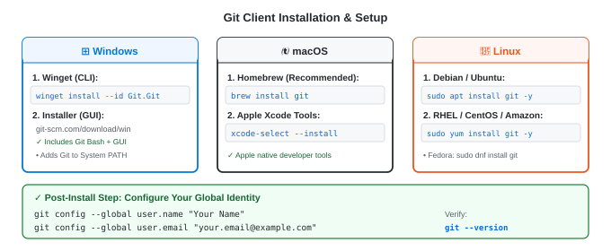

# Git Client Installation Guide

---

<details>
<summary><strong>How do you check if Git is already installed?</strong></summary>

<br>

Open your terminal (PowerShell, Command Prompt, macOS Terminal, or Linux Bash) and run:

```bash
git --version
```

- **If installed**: You will see output like `git version 2.44.0` (or similar).
- **If not installed**: You will see an error such as `'git' is not recognized` (Windows) or `command not found: git` (Mac/Linux).

</details>

---

<details>
<summary><strong>How to install Git on Windows?</strong></summary>

<br>

### Method 1: Using Windows Package Manager (Winget) — Fast &amp; Clean

Open PowerShell as an Administrator and execute:

```powershell
winget install --id Git.Git -e --source winget
```

After the command completes, restart your terminal and verify:
```powershell
git --version
```

---

### Method 2: Using the Official Standalone Installer (.exe)

1. Download the installer from the official site: **[git-scm.com/download/win](https://git-scm.com/download/win)**
2. Run the downloaded `.exe` file.
3. During setup, keep standard defaults with these recommended choices:
   - **Default Editor**: Visual Studio Code (or Nano)
   - **Adjusting your PATH environment**: Choose *"Git from the command line and also from 3rd-party software"*
   - **Line ending conversions**: Choose *"Checkout Windows-style, commit Unix-style line endings"* (`core.autocrlf = true`)
   - **Terminal emulator**: Choose *"Use MinTTY (the default terminal of MSYS2)"* to get **Git Bash**
4. Click **Install** and finish.

</details>

---

<details>
<summary><strong>How to install Git on macOS?</strong></summary>

<br>

### Method 1: Using Homebrew (Recommended)

If you have Homebrew installed, run:

```bash
brew install git
```

To update Git in the future:
```bash
brew upgrade git
```

---

### Method 2: Using Apple Xcode Command Line Tools

If you don't have Homebrew, you can install Apple's official developer CLI tools:

```bash
xcode-select --install
```

A software update dialog will appear. Click **Install** and accept the license terms.

Verify the installation:
```bash
git --version
```

</details>

---

<details>
<summary><strong>How to install Git on Linux?</strong></summary>

<br>

### Ubuntu / Debian / Linux Mint:

```bash
sudo apt update
sudo apt install git -y
```

---

### RHEL / CentOS / Rocky Linux / AlmaLinux:

```bash
# RHEL 8/9, Rocky, Alma:
sudo dnf install git -y

# CentOS 7 / Amazon Linux:
sudo yum install git -y
```

---

### Fedora:

```bash
sudo dnf install git -y
```

---

### Arch Linux / Manjaro:

```bash
sudo pacman -S git --noconfirm
```

---

### Alpine Linux:

```bash
apk add git
```

</details>

---

<details>
<summary><strong>First-Time Git Configuration (Crucial Post-Install Step)</strong></summary>

<br>

Every Git commit records your identity (name and email). You must configure this once on your machine:

### 1. Set your Name and Email:
```bash
git config --global user.name "Your Full Name"
git config --global user.email "your.email@example.com"
```

### 2. Set default branch name to `main`:
```bash
git config --global init.defaultBranch main
```

### 3. Verify your configuration:
```bash
git config --list --show-origin
```

You should see your configured username and email stored inside your global `.gitconfig` file (located in your user home directory: `~/.gitconfig` or `C:\Users\<user>\.gitconfig`).

</details>

---

<details>
<summary><strong>Quick Overview &amp; OS Comparison</strong></summary>

<br>



| Operating System | Recommended Installation Method | Alternate Method |
|---|---|---|
| **Windows** | `winget install --id Git.Git -e --source winget` | Standalone Installer (.exe) with Git Bash |
| **macOS** | `brew install git` (Homebrew) | `xcode-select --install` (Apple Developer Tools) |
| **Linux (Ubuntu/Debian)** | `sudo apt update && sudo apt install git -y` | Compile from source |
| **Linux (RHEL/CentOS/Rocky)** | `sudo dnf install git -y` or `sudo yum install git -y` | — |

</details>
