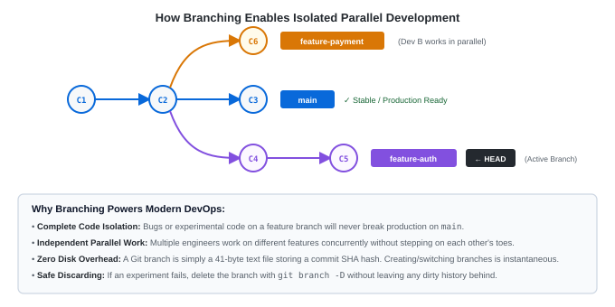

# Lab 02: Creating, Switching & Managing Local Branches

---

## 🎯 Lab Objectives
In this hands-on lab, you will master **local branch management**:
1. Check existing branches and decode the active `HEAD` branch (`git branch`).
2. Create and switch to new branches using modern commands (`git switch`, `git switch -c`).
3. Make isolated commits on different branches and observe how file states change when switching.
4. Peek under the hood into `.git/refs/heads/` to prove branches are just 41-byte pointers!
5. Safely delete branches (`git branch -d`) and force-delete unmerged experimental branches (`git branch -D`).

---

## 📋 Prerequisites
- Completed [Lab 01: Git Basic Workflow & File Lifecycle](./lab01-basic-workflow.md).
- Terminal open and ready.

---

## 🗺️ Visual Architecture



---

## 🚀 Step-by-Step Instructions

### Step 1: Create a Sandbox Repository
Let's create a fresh practice directory to experiment with branches:

```bash
mkdir -p ~/git-practice/branching-lab
cd ~/git-practice/branching-lab
git init
```

Create an initial base file and commit it on `main`:
```bash
echo "# E-Commerce Store" > README.md
git add README.md
git commit -m "chore: initial commit on main"
```

Verify your current branch:
```bash
git branch
```

**Expected Output:**
```text
* main
```
> The asterisk `*` indicates that `HEAD` is currently pointing to `main`.

---

### Step 2: Create a Branch (Method A: Create & Switch in Two Steps)
To create a branch without switching to it yet:

```bash
git branch feature-cart
```

List all branches:
```bash
git branch
```
```text
  feature-cart
* main
```
> Notice that `feature-cart` was created, but you are still on `main` (marked by `*`).

Now switch to it:
```bash
git switch feature-cart
```
*(Or classic command: `git checkout feature-cart`)*

**Expected Output:**
```text
Switched to branch 'feature-cart'
```

Verify with `git branch`:
```text
* feature-cart
  main
```

---

### Step 3: Create & Switch in One Command (Method B: Recommended)
You can create and immediately switch in a single command using `git switch -c`:

```bash
# Return to main first:
git switch main

# Create and switch to feature-payment in one step:
git switch -c feature-payment
```
*(Or classic command: `git checkout -b feature-payment`)*

**Expected Output:**
```text
Switched to a new branch 'feature-payment'
```

---

### Step 4: Make Isolated Commits on Your Branch
On `feature-payment`, create a new payment processing file:

```bash
echo "def process_stripe(): pass" > payment.py
git add payment.py
git commit -m "feat: add payment processing skeleton"
```

Check your commit history:
```bash
git log --oneline
```
```text
c3d4e5f (HEAD -> feature-payment) feat: add payment processing skeleton
a1b2c3d (main, feature-cart) chore: initial commit on main
```
> Notice: `HEAD` is pointing to `feature-payment`. `main` is still resting at commit `a1b2c3d`.

---

### Step 5: Observe Workspace File Isolation
Look at your current workspace files:
```bash
ls
```
```text
README.md  payment.py
```

Now, switch back to `main`:
```bash
git switch main
```

Look at the files again:
```bash
ls
```
```text
README.md
```
> [!NOTE]
> **Look! `payment.py` disappeared from your workspace!**
> Because Git swapped your workspace files to match `main`'s snapshot. Your payment code is safely stored on the `feature-payment` branch, completely isolated from `main`.

Switch back to `feature-payment`:
```bash
git switch feature-payment
ls
```
> `payment.py` is right back!

---

### Step 6: Under the Hood — Peek into `.git/refs/heads/`
Let's see what a Git branch really is on your hard drive:

```bash
cat .git/refs/heads/feature-payment
```
**Output:**
```text
c3d4e5f12a3b4c5d6e7f8a9b0c1d2e3f4a5b6c7d
```

```bash
cat .git/refs/heads/main
```
**Output:**
```text
a1b2c3d4e5f6a7b8c9d0e1f2a3b4c5d6e7f8a9b0
```

> **Proof!** A branch is literally just a 41-byte text file storing the 40-character commit hash!

Now inspect `HEAD`:
```bash
cat .git/HEAD
```
**Output:**
```text
ref: refs/heads/feature-payment
```
> `HEAD` simply contains a reference to the active branch file!

---

### Step 7: Deleting Branches (`git branch -d` vs `git branch -D`)

Switch back to `main`:
```bash
git switch main
```

#### Safe Delete: `git branch -d`
Try deleting `feature-cart` (which has no unique commits):
```bash
git branch -d feature-cart
```
```text
Deleted branch feature-cart (was a1b2c3d).
```

#### Protected Delete against Unmerged Work:
Now try deleting `feature-payment` using the safe `-d` flag:
```bash
git branch -d feature-payment
```

**Expected Git Error:**
```text
error: The branch 'feature-payment' is not fully merged.
If you are sure you want to delete it, run 'git branch -D feature-payment'.
```
> [!IMPORTANT]
> Git protects you from accidentally destroying unmerged work!

#### Force Delete: `git branch -D`
If you decide an experiment is completely discarded and you want to throw it away intentionally, use the uppercase `-D` flag:

```bash
git branch -D feature-payment
```
**Expected Output:**
```text
Deleted branch feature-payment (was c3d4e5f).
```

---

## 🏆 Summary Cheat Sheet

| Command | Action |
|---|---|
| `git branch` | List all local branches (current marked with `*`) |
| `git branch <name>` | Create a new branch without switching |
| `git switch <name>` | Switch to an existing branch |
| `git switch -c <name>` | Create and immediately switch to new branch |
| `git branch -d <name>` | Safely delete a merged branch |
| `git branch -D <name>` | Force delete a branch with unmerged work |
| `cat .git/HEAD` | View which branch HEAD currently points to |

