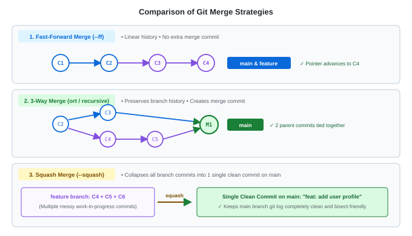

# Lab 03: Practicing Git Merge Strategies (Fast-Forward, 3-Way & Squash)

---

## 🎯 Lab Objectives
In this hands-on lab, you will practice the three primary merge strategies used in software & DevOps workflows:
1. **Fast-Forward Merge** (`--ff`): Linear advancement with zero extra commits.
2. **Explicit Merge Commit** (`--no-ff`): Forcing a merge commit for auditability.
3. **3-Way Merge** (Automatic): Merging diverged branches.
4. **Squash Merge** (`--squash`): Condensing multiple messy commits into one clean commit.
5. Inspect the graphical history with `git log --graph --oneline`.

---

## 📋 Prerequisites
- Completed [Lab 02: Creating, Switching & Managing Local Branches](./lab02-branching-local.md).
- Terminal open and ready.

---

## 🗺️ Visual Comparison



---

## 🚀 Step-by-Step Instructions

### Step 1: Create a Sandbox Repository
Let's start fresh in a clean directory:

```bash
mkdir -p ~/git-practice/strategies-lab
cd ~/git-practice/strategies-lab
git init
```

Create base project files on `main`:
```bash
echo "# Payment Gateway Service" > README.md
git add README.md
git commit -m "chore: initial commit on main"
```

---

### Step 2: Practice Fast-Forward Merge (`--ff`)

1. Create a feature branch:
   ```bash
   git switch -c feat-stripe
   ```

2. Add a new file and commit:
   ```bash
   echo "def charge_card(): pass" > stripe.py
   git add stripe.py
   git commit -m "feat: add stripe integration"
   ```

3. Switch back to `main`:
   ```bash
   git switch main
   ```

4. Merge `feat-stripe`:
   ```bash
   git merge feat-stripe
   ```

**Expected Output:**
```text
Updating a1b2c3d..b2c3d4e
Fast-forward
 stripe.py | 1 +
 1 file changed, 1 insertion(+)
 create mode 100644 stripe.py
```
> Notice `Fast-forward`. Run `git log --oneline`. You will see a straight linear history with no extra commit.

Clean up:
```bash
git branch -d feat-stripe
```

---

### Step 3: Practice No Fast-Forward (`--no-ff`)
Sometimes teams want an explicit merge commit to document that a feature was integrated, even if history is linear.

1. Create branch `feat-paypal`:
   ```bash
   git switch -c feat-paypal
   ```

2. Commit a change:
   ```bash
   echo "def charge_paypal(): pass" > paypal.py
   git add paypal.py
   git commit -m "feat: add paypal integration"
   ```

3. Switch back to `main`:
   ```bash
   git switch main
   ```

4. Merge with `--no-ff`:
   ```bash
   git merge --no-ff feat-paypal -m "merge: integrate paypal feature into main"
   ```

**Expected Output:**
```text
Merge made by the 'ort' strategy.
 paypal.py | 1 +
 1 file changed, 1 insertion(+)
 create mode 100644 paypal.py
```

Inspect the graph:
```bash
git log --oneline --graph -n 3
```
```text
*   d4e5f6a (HEAD -> main) merge: integrate paypal feature into main
|\  
| * c3d4e5f (feat-paypal) feat: add paypal integration
|/  
* b2c3d4e feat: add stripe integration
```
> Notice that a dedicated merge commit was created!

Clean up:
```bash
git branch -d feat-paypal
```

---

### Step 4: Practice 3-Way Merge (Diverging Branches)

1. Create a branch `feat-applepay`:
   ```bash
   git switch -c feat-applepay
   ```
2. Commit on `feat-applepay`:
   ```bash
   echo "def charge_apple(): pass" > applepay.py
   git add applepay.py
   git commit -m "feat: add apple pay integration"
   ```

3. Switch back to `main`:
   ```bash
   git switch main
   ```

4. Make a simultaneous commit directly on `main`:
   ```bash
   echo "MAINTAINER = 'DevOps Team'" > config.py
   git add config.py
   git commit -m "chore: add maintainer configuration"
   ```

5. Both branches have diverged! Check the tree:
   ```bash
   git log --oneline --graph --all
   ```

6. Merge `feat-applepay` into `main`:
   ```bash
   git merge feat-applepay -m "merge: integrate apple pay into main"
   ```

Inspect the graph:
```bash
git log --oneline --graph -n 4
```

Clean up:
```bash
git branch -d feat-applepay
```

---

### Step 5: Practice Squash Merge (`--squash`)
This is the gold standard for Pull Requests in production repos!

1. Create a branch `feat-user-auth`:
   ```bash
   git switch -c feat-user-auth
   ```

2. Make 3 small, messy work-in-progress commits:
   ```bash
   # Commit 1
   echo "def login():" > auth.py
   git add auth.py
   git commit -m "wip: start login function"

   # Commit 2
   echo "    print('authenticating')" >> auth.py
   git add auth.py
   git commit -m "fix typo in login print"

   # Commit 3
   echo "    return True" >> auth.py
   git add auth.py
   git commit -m "test login functionality"
   ```

3. Switch back to `main`:
   ```bash
   git switch main
   ```

4. Perform the squash merge:
   ```bash
   git merge --squash feat-user-auth
   ```

**Expected Output:**
```text
Squash commit -- not updating HEAD
Automatic merge went well; stopped before committing as requested
```

5. Check `git status`:
   ```bash
   git status
   ```
   > All changes from the 3 commits are staged together in the Staging Area!

6. Commit the clean, single atomic message:
   ```bash
   git commit -m "feat: implement complete user login authentication"
   ```

7. Verify history:
   ```bash
   git log --oneline -n 3
   ```
   > None of the messy commits (`"wip"`, `"fix typo"`) appear on `main`. Only one clean, professional commit!

Clean up:
```bash
git branch -D feat-user-auth
```

---

## 🏆 Summary Cheat Sheet

| Merge Command | Behavior |
|---|---|
| `git merge <branch>` | Default merge: Fast-forward if possible, otherwise 3-way merge |
| `git merge --no-ff <branch>` | Always forces creation of a merge commit |
| `git merge --squash <branch>` | Stages all branch changes into one commit (requires manual `git commit`) |
| `git log --graph --oneline --all` | Visualizes the branch and merge tree |

