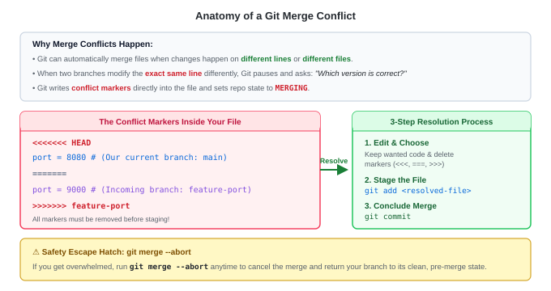

# Lab 04: Git Merge Conflict Resolution (Hands-On Lab)

---

## 🎯 Lab Objectives
In this hands-on lab, you will:
1. Understand why and when Git stops an automatic merge.
2. Deliberately trigger a real-world merge conflict between two branches.
3. Inspect and decode Git's conflict markers (`<<<<<<<`, `=======`, `>>>>>>>`).
4. Practice using the emergency escape hatch: **`git merge --abort`**.
5. Manually resolve the conflict, stage the fix, and conclude the merge commit.
6. Verify the final clean state using `git log --graph --oneline`.

---

## 📋 Prerequisites
- Completed [Lab 01: Git Basic Workflow](./lab01-basic-workflow.md).
- Terminal access (PowerShell, Git Bash, macOS Terminal, or Linux terminal).

---

## 🗺️ Visual Conflict Lifecycle



---

## 🚀 Step-by-Step Instructions

### Step 1: Create a Dedicated Practice Sandbox
Create a fresh repository so you can experiment freely without affecting any other work:

```bash
mkdir -p ~/git-practice/conflict-lab
cd ~/git-practice/conflict-lab
git init
```

Create an initial configuration file on `main`:
```bash
cat << 'EOF' > server.conf
# Server Configuration File
SERVER_NAME=prod-server
PORT=80
MAX_CONNECTIONS=100
LOG_LEVEL=INFO
EOF

git add server.conf
git commit -m "chore: initial server configuration on main"
```

Verify your starting point:
```bash
git log --oneline
```
```text
a1b2c3d (HEAD -> main) chore: initial server configuration on main
```

---

### Step 2: Create a Feature Branch and Change the Port
You are tasked with updating the port to `8080` on branch `feature-port-8080`:

```bash
git switch -c feature-port-8080
```

Change the `PORT` line from `80` to `8080`:
```bash
cat << 'EOF' > server.conf
# Server Configuration File
SERVER_NAME=prod-server
PORT=8080
MAX_CONNECTIONS=100
LOG_LEVEL=INFO
EOF

git add server.conf
git commit -m "feat: update server port to 8080 for web proxy"
```

Check your branch commit:
```bash
git log --oneline -n 2
```
```text
b2c3d4e (HEAD -> feature-port-8080) feat: update server port to 8080 for web proxy
a1b2c3d chore: initial server configuration on main
```

---

### Step 3: Switch to `main` and Make a Conflicting Change
Meanwhile, another engineer working on `main` changed the exact same line to port `9000`:

```bash
git switch main
```

Update `PORT` to `9000` on `main`:
```bash
cat << 'EOF' > server.conf
# Server Configuration File
SERVER_NAME=prod-server
PORT=9000
MAX_CONNECTIONS=100
LOG_LEVEL=INFO
EOF

git add server.conf
git commit -m "fix: change port to 9000 to prevent port clash"
```

Both branches now have different values on the exact same line (`PORT=8080` vs `PORT=9000`).

---

### Step 4: Attempt the Merge & Trigger the Conflict
Now, attempt to merge `feature-port-8080` into `main`:

```bash
git merge feature-port-8080
```

**Expected Terminal Output:**
```text
Auto-merging server.conf
CONFLICT (content): Merge conflict in server.conf
Automatic merge failed; fix conflicts and then commit the result.
```

> [!WARNING]
> Your terminal prompt may now display `(main|MERGING)`. This indicates Git is paused in the middle of a merge waiting for your decision!

---

### Step 5: Inspect the Conflict State
Check `git status`:

```bash
git status
```

**Expected Output:**
```text
On branch main
You have unmerged paths.
  (fix conflicts and run "git commit")
  (use "git merge --abort" to abort the merge)

Unmerged paths:
  (use "git add <file>..." to mark resolution)
	both modified:   server.conf

no changes added to commit (use "git add" and/or "git commit -a")
```
> Notice `both modified: server.conf`.

Now inspect the conflict markers inside the file:
```bash
cat server.conf
```

**What the file looks like:**
```text
# Server Configuration File
SERVER_NAME=prod-server
<<<<<<< HEAD
PORT=9000
=======
PORT=8080
>>>>>>> feature-port-8080
MAX_CONNECTIONS=100
LOG_LEVEL=INFO
```

### Decoding the Markers:
- **`<<<<<<< HEAD`**: Top boundary. Shows the code on your currently checked-out branch (`main` &rarr; `PORT=9000`).
- **`=======`**: Middle divider separating the two competing versions.
- **`>>>>>>> feature-port-8080`**: Bottom boundary. Shows the incoming change from the branch being merged (`PORT=8080`).

---

### Step 6: Test the Emergency Escape Hatch (`git merge --abort`)
Before resolving the conflict, let's practice aborting. If you ever feel stuck or realize you merged the wrong branch in production:

```bash
git merge --abort
```

Verify your repository state:
```bash
git status
```
```text
On branch main
nothing to commit, working tree clean
```
And check the file:
```bash
cat server.conf
```
> The conflict markers are completely gone! You are safely back to where you started before the merge attempt.

---

### Step 7: Re-Trigger and Resolve the Conflict
Now re-run the merge so we can resolve it properly:

```bash
git merge feature-port-8080
```

#### Choose the Resolution:
Suppose after talking with your team, you decide **Port 8080** is the correct choice.

Edit `server.conf` and clean out all conflict markers (`<<<<<<<`, `=======`, `>>>>>>>`):

```bash
cat << 'EOF' > server.conf
# Server Configuration File
SERVER_NAME=prod-server
PORT=8080
MAX_CONNECTIONS=100
LOG_LEVEL=INFO
EOF
```

Verify the file has no remaining conflict markers:
```bash
cat server.conf
```

---

### Step 8: Stage the Resolved File
Tell Git that you have resolved the conflict on this file by running `git add`:

```bash
git add server.conf
git status
```

**Expected Output:**
```text
On branch main
All conflicts fixed but you are still merging.
  (use "git commit" to conclude merge)

Changes to be committed:
	modified:   server.conf
```
> Git acknowledges: `All conflicts fixed but you are still merging.`

---

### Step 9: Finalize the Merge Commit
Seal the merge by running `git commit`:

```bash
git commit -m "merge: resolve port conflict by accepting 8080"
```

**Expected Output:**
```text
[main c4d5e6f] merge: resolve port conflict by accepting 8080
```

Verify your clean commit history:
```bash
git status
```
```text
On branch main
nothing to commit, working tree clean
```

View the complete graphical merge history:
```bash
git log --oneline --graph --all
```

**Expected Output:**
```text
*   c4d5e6f (HEAD -> main) merge: resolve port conflict by accepting 8080
|\  
| * b2c3d4e (feature-port-8080) feat: update server port to 8080 for web proxy
* | d3e4f5a fix: change port to 9000 to prevent port clash
|/  
* a1b2c3d chore: initial server configuration on main
```

---

### Step 10: Clean Up
Now that `feature-port-8080` is fully merged, delete the feature branch:

```bash
git branch -d feature-port-8080
```

---

## 🏆 Summary Checklist
- [x] Identified why Git paused during the merge.
- [x] Decoded `<<<<<<< HEAD`, `=======`, and `>>>>>>>`.
- [x] Tested `git merge --abort` to safely cancel an unmerged state.
- [x] Cleaned out conflict markers and picked the correct configuration.
- [x] Marked resolution with `git add` and committed with `git commit`.

