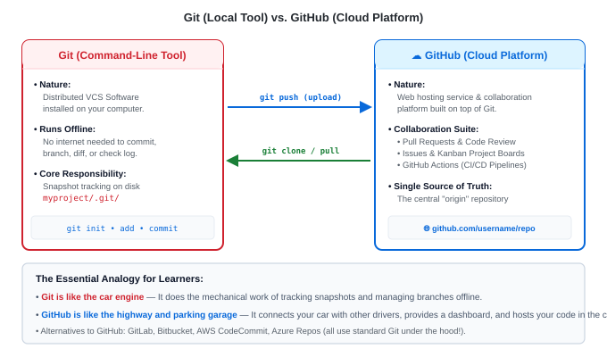

# Lab 05: GitHub Basics — Create, Clone, Push & Pull

---

## 🎯 Lab Objectives
In this hands-on lab, you will connect your local machine to the cloud and master the fundamental GitHub lifecycle:
1. Create a brand-new repository on **GitHub.com** with an initial `README.md`.
2. Clone the repository down to your local workstation (`git clone`).
3. Discover what `git clone` sets up automatically (`origin`, remote-tracking branches).
4. Add new files locally, commit, and push back to GitHub (`git push`).
5. Simulate a teammate's update by editing a file directly on GitHub's Web UI.
6. Synchronize your local machine with the cloud changes (`git pull`).
7. Verify that your local history and GitHub cloud history are in sync.

---

## 📋 Prerequisites
- A free account on **[GitHub.com](https://github.com)**.
- Git client installed locally ([Lab 00: Installation Guide](./lab00-installation.md)).
- Basic Git commands familiarity (`add`, `commit`, `status`, `log`).

---

## 🗺️ The Clone, Push & Pull Cycle



---

## 🚀 Step-by-Step Instructions

### Step 1: Create a New Repository on GitHub (Cloud)
1. Open your web browser and go to **[GitHub.com](https://github.com)**.
2. In the top-right corner, click the **`+`** icon &rarr; select **New repository**.
3. Fill in the repository details:
   - **Repository name**: `github-starter-lab`
   - **Description**: `Hands-on practice repository for clone, push, and pull`
   - **Visibility**: Choose **Public** (or Private)
4. Under **Initialize this repository with**:
   - Check the box: **Add a README file**
   - **Add .gitignore**: Choose `Python` (or `Node`, or None)
5. Click **Create repository**.

> [!NOTE]
> GitHub has created your repository in the cloud with commit `Initial commit`.

---

### Step 2: Copy the Clone URL
On your newly created GitHub repository page:
1. Click the green **`<> Code`** button.
2. Choose your preferred protocol:
   - **SSH** (Recommended if you configured SSH keys): `git@github.com:username/github-starter-lab.git`
   - **HTTPS**: `https://github.com/username/github-starter-lab.git`
3. Click the copy icon to copy the URL to your clipboard.

---

### Step 3: Clone the Repository to Your Local Machine
Open your terminal and navigate to your practice folder, then run `git clone`:

```bash
mkdir -p ~/git-practice
cd ~/git-practice

# Replace with your actual repository URL:
git clone git@github.com:username/github-starter-lab.git
```
*(Or use the HTTPS URL if you haven't set up SSH yet)*

**Expected Terminal Output:**
```text
Cloning into 'github-starter-lab'...
remote: Enumerating objects: 4, done.
remote: Counting objects: 100% (4/4), done.
remote: Compressing objects: 100% (3/3), done.
remote: Total 4 (delta 0), reused 0 (delta 0), pack-reused 0
Receiving objects: 100% (4/4), done.
```

---

### Step 4: Inspect What `git clone` Did Automatically
Navigate into your newly cloned folder:

```bash
cd github-starter-lab
ls -la
```

Notice:
1. `git clone` created the project folder and copied all files (`README.md`, `.gitignore`).
2. It initialized the hidden **`.git/`** directory.
3. Check your configured remote links:
   ```bash
   git remote -v
   ```
   **Output:**
   ```text
   origin  git@github.com:username/github-starter-lab.git (fetch)
   origin  git@github.com:username/github-starter-lab.git (push)
   ```
   > Git automatically named the cloud server **`origin`**!

4. Check your commit history:
   ```bash
   git log --oneline
   ```
   **Output:**
   ```text
   a1b2c3d (HEAD -> main, origin/main, origin/HEAD) Initial commit
   ```
   > Notice `HEAD -> main` (your local branch) and `origin/main` (the cloud branch) are pointing to the exact same commit!

---

### Step 5: Make Local Changes & Commit
Let's add a new script file to our local repository:

```bash
cat << 'EOF' > app.py
def welcome():
    print("Hello from DevOps GitHub Lab!")

if __name__ == "__main__":
    welcome()
EOF
```

Check `git status`:
```bash
git status
```
```text
Untracked files:
	app.py
```

Stage and commit your new file:
```bash
git add app.py
git commit -m "feat: add welcome script app.py"
```

Check your commit log now:
```bash
git log --oneline -n 2
```
```text
b2c3d4e (HEAD -> main) feat: add welcome script app.py
a1b2c3d (origin/main, origin/HEAD) Initial commit
```
> [!IMPORTANT]
> **Look closely at the output above!**
> - Your local `main` has advanced to commit `b2c3d4e`.
> - The cloud repository `origin/main` is still resting at `a1b2c3d`.
> - Your local machine is now **1 commit ahead of the cloud**!

---

### Step 6: Push Changes to GitHub (`git push`)
Now upload your local commit to GitHub in the cloud:

```bash
git push origin main
```
*(Or simply `git push`, since `clone` already established upstream tracking!)*

**Expected Terminal Output:**
```text
Enumerating objects: 4, done.
Counting objects: 100% (4/4), done.
Writing objects: 100% (3/3), 320 bytes | 320.00 KiB/s, done.
Total 3 (delta 0), reused 0 (delta 0)
To github.com:username/github-starter-lab.git
   a1b2c3d..b2c3d4e  main -> main
```

**Verify in your browser:**
Refresh your repository page on **GitHub.com**. You will see:
- `app.py` is now listed in the file browser.
- The commit message `feat: add welcome script app.py` appears next to it.
- Commit count has increased to 2!

---

### Step 7: Simulate a Remote Update on GitHub Web UI
In a team, your colleagues or CI systems will constantly push changes to GitHub that you don't have on your laptop yet. Let's simulate this!

1. In your browser on **GitHub.com**, click on **`README.md`**.
2. Click the small **Pencil icon** (Edit this file) in the top-right of the file viewer.
3. Add a line to the bottom of the file:
   ```markdown
   ## Features
   - Python welcome script
   - Automated cloud syncing
   ```
4. Scroll down to **Commit changes...**:
   - Message: `docs: update README with features list`
   - Select: *Commit directly to the `main` branch*
   - Click **Commit changes**.

> Now GitHub (the cloud) is **1 commit ahead** of your local machine!

---

### Step 8: Pull Remote Changes Down Locally (`git pull`)
Switch back to your local terminal.

Before pulling, check `cat README.md`:
```bash
cat README.md
```
> Notice that the `## Features` section is NOT on your laptop yet!

Now pull down the cloud changes:
```bash
git pull origin main
```
*(Or simply `git pull`)*

**Expected Terminal Output:**
```text
remote: Enumerating objects: 5, done.
remote: Counting objects: 100% (5/5), done.
remote: Compressing objects: 100% (3/3), done.
remote: Total 3 (delta 1), reused 0 (delta 0), pack-reused 0
Unpacking objects: 100% (3/3), 640 bytes | 640.00 KiB/s, done.
From github.com:username/github-starter-lab
 * branch            main       -> FETCH_HEAD
   b2c3d4e..c3d4e5f  main       -> origin/main
Updating b2c3d4e..c3d4e5f
Fast-forward
 README.md | 4 ++++
 1 file changed, 4 insertions(+)
```

Verify your local file now:
```bash
cat README.md
```
> The new features section is now on your laptop!

Inspect your synchronized commit history:
```bash
git log --oneline -n 3
```
**Expected Output:**
```text
c3d4e5f (HEAD -> main, origin/main, origin/HEAD) docs: update README with features list
b2c3d4e feat: add welcome script app.py
a1b2c3d Initial commit
```
> `HEAD -> main` (local) and `origin/main` (cloud) are once again pointing to the exact same commit!

---

## 📋 Core Commands Cheat Sheet

| Command | What It Does |
|---|---|
| `git clone <url>` | Downloads a remote repository, history, branches, and configures `origin` |
| `git remote -v` | Displays the configured remote URLs (fetch & push) |
| `git push` | Uploads local commits from your current branch to GitHub |
| `git pull` | Downloads new commits from GitHub and merges them into your local files |
| `git fetch` | Downloads new commits from GitHub into `origin/main` without modifying local files |

