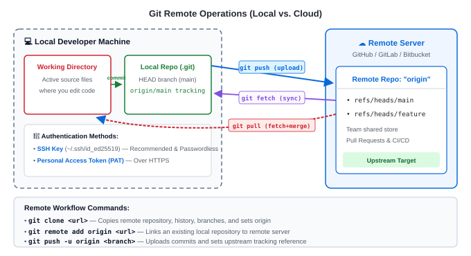

# Lab 06: Remote Collaboration & GitHub Flow (Hands-On Lab)

---

## 🎯 Lab Objectives
In this hands-on lab, you will connect your local Git environment to the cloud and execute the **GitHub Flow** team collaboration lifecycle:
1. Generate and configure an SSH key (`id_ed25519`) for passwordless remote authentication.
2. Link your local repository to a remote GitHub / GitLab repository (`git remote add origin`).
3. Push branches to the cloud with upstream tracking (`git push -u origin <branch>`).
4. Execute the complete **GitHub Flow**:
   - Create a feature branch &rarr; Push to remote &rarr; Open a Pull Request (PR) &rarr; Merge into `main`.
5. Sync your local `main` with the cloud repository (`git pull`).
6. Clean up both local and remote feature branches.

---

## 📋 Prerequisites
- A free account on **[GitHub.com](https://github.com)** (or GitLab).
- Git installed on your computer ([Lab 00](./lab00-installation.md)).

---

## 🗺️ Remote Architecture Overview



---

## 🚀 Step-by-Step Instructions

### Step 1: Generate an SSH Key Pair
SSH keys allow you to authenticate with GitHub securely without entering passwords or tokens repeatedly.

Open your terminal and generate an Ed25519 key (modern, secure standard):

```bash
ssh-keygen -t ed25519 -C "your.email@example.com"
```

- When prompted for file path: Press **Enter** to accept the default (`~/.ssh/id_ed25519`).
- When prompted for a passphrase: Press **Enter** (or enter a passphrase if desired).

Now, copy your **public key** to your clipboard:

```bash
# On macOS:
pbcopy < ~/.ssh/id_ed25519.pub

# On Linux:
cat ~/.ssh/id_ed25519.pub
# (Select and copy the output)

# On Windows (Git Bash):
clip < ~/.ssh/id_ed25519.pub
```

---

### Step 2: Add Your SSH Key to GitHub
1. Log in to **[GitHub.com](https://github.com)**.
2. Click your profile avatar (top right) &rarr; **Settings**.
3. In the left sidebar, click **SSH and GPG keys**.
4. Click **New SSH key**.
5. Title: `My Laptop` (or any label).
6. Key: Paste the copied public key.
7. Click **Add SSH key**.

Verify the SSH connection in your terminal:
```bash
ssh -T git@github.com
```

**Expected Output:**
```text
Hi username! You've successfully authenticated, but GitHub does not provide shell access.
```

---

### Step 3: Create a Remote Repository on GitHub
1. On GitHub, click the **`+`** icon (top right) &rarr; **New repository**.
2. Repository name: `devops-cloud-app`.
3. Description: `Practice repository for GitHub Flow`.
4. Choose **Public** (or Private).
5. **Important**: Leave "Add a README file" **unchecked** (we will push an existing repo).
6. Click **Create repository**.
7. Copy the **SSH URL** (format: `git@github.com:username/devops-cloud-app.git`).

---

### Step 4: Initialize & Link Your Local Repository
In your local terminal, create the project directory:

```bash
mkdir -p ~/git-practice/devops-cloud-app
cd ~/git-practice/devops-cloud-app
git init
```

Create an initial `README.md` and commit it:
```bash
echo "# DevOps Cloud App" > README.md
git add README.md
git commit -m "chore: initial commit"
```

Ensure your default branch is named `main`:
```bash
git branch -M main
```

Now, link your local repo to GitHub using your copied SSH URL:
```bash
git remote add origin git@github.com:username/devops-cloud-app.git
```

Verify the remote link:
```bash
git remote -v
```
**Expected Output:**
```text
origin  git@github.com:username/devops-cloud-app.git (fetch)
origin  git@github.com:username/devops-cloud-app.git (push)
```

---

### Step 5: Push `main` to Remote with Upstream Tracking
Push your `main` branch to GitHub for the first time using the `-u` (upstream) flag:

```bash
git push -u origin main
```

**Expected Output:**
```text
Enumerating objects: 3, done.
Counting objects: 100% (3/3), done.
Writing objects: 100% (3/3), 220 bytes | 220.00 KiB/s, done.
Total 3 (delta 0), reused 0 (delta 0)
To github.com:username/devops-cloud-app.git
 * [new branch]      main -> main
branch 'main' set up to track 'origin/main'.
```

> [!NOTE]
> The `-u` flag creates a permanent link between your local `main` and remote `origin/main`. In the future, you can simply type `git push` or `git pull` without specifying the remote or branch!

Refresh your GitHub repository in your web browser. You will see your `README.md` live!

---

### Step 6: Practice GitHub Flow (Branch &rarr; Code &rarr; Push)
Now simulate building a new feature following industry best practices.

1. Create and switch to a feature branch:
   ```bash
   git switch -c feat/health-check
   ```

2. Add a health-check endpoint file:
   ```bash
   cat << 'EOF' > health.py
   def health_status():
       return {"status": "healthy", "version": "1.0.0"}
   EOF

   git add health.py
   git commit -m "feat: add application health check endpoint"
   ```

3. Push the feature branch to GitHub with upstream tracking:
   ```bash
   git push -u origin feat/health-check
   ```

**Expected Output:**
```text
Total 3 (delta 0), reused 0 (delta 0)
remote: 
remote: Create a pull request for 'feat/health-check' on GitHub by visiting:
remote:      https://github.com/username/devops-cloud-app/pull/new/feat/health-check
remote: 
To github.com:username/devops-cloud-app.git
 * [new branch]      feat/health-check -> feat/health-check
```

---

### Step 7: Open & Merge a Pull Request (PR) on GitHub
1. Go to your repository on **GitHub.com**.
2. You will see a yellow banner: **"feat/health-check had recent pushes"** &rarr; Click **Compare & pull request**.
3. Title: `feat: add application health check endpoint`.
4. Description: `Adds health check function returning status and version.`
5. Click **Create pull request**.
6. Review the **Files changed** tab to see your diff.
7. Click **Merge pull request** &rarr; **Confirm merge**.
8. Notice GitHub now gives you a button: **Delete branch** &rarr; Click it to clean up the remote branch!

---

### Step 8: Sync Local `main` with Remote (`git pull`)
Now your feature is merged on GitHub, but your local `main` does not have it yet!

1. Switch to your local `main`:
   ```bash
   git switch main
   ```

2. Notice that `health.py` is not in your local folder yet.
3. Pull down the merged commits from GitHub:
   ```bash
   git pull
   ```

**Expected Output:**
```text
Updating a1b2c3d..b2c3d4e
Fast-forward
 health.py | 3 +++
 1 file changed, 3 insertions(+)
 create mode 100644 health.py
```
`health.py` is now on your local `main`!

---

### Step 9: Clean Up Local Feature Branch
Delete the local branch that has already been merged:

```bash
git branch -d feat/health-check
```

Prune any deleted remote tracking branches:
```bash
git fetch --prune
```

---

## 📋 Remote Commands Quick Reference

| Command | Action |
|---|---|
| `git remote add origin <url>` | Connect local repository to remote cloud host |
| `git remote -v` | View configured remote URLs |
| `git push -u origin <branch>` | Push branch and set upstream tracking |
| `git push` | Push commits to currently tracked upstream branch |
| `git pull` | Fetch changes from remote AND merge into current branch |
| `git fetch` | Download new commits/branches without merging into files |
| `git push origin --delete <branch>` | Delete a branch on the remote server |
