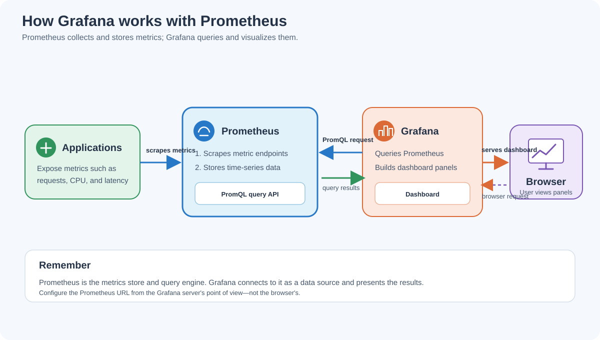

# What Is Grafana? Architecture Overview

Grafana is an observability and visualization platform. It connects to data sources, queries them, and displays the results in dashboards. Prometheus commonly stores metrics and evaluates PromQL queries, while Grafana provides the dashboard interface for exploring those metrics.

Grafana does **not** normally collect or store the metrics shown in a Prometheus dashboard. Prometheus scrapes and stores metrics; Grafana queries Prometheus and visualizes the results.

## Grafana architecture

### Request and data flow

1. Applications and exporters expose metrics endpoints.
2. Prometheus periodically scrapes those endpoints and stores the samples in its time-series database.
3. A user opens a Grafana dashboard in a browser.
4. Grafana sends the dashboard's queries to its configured data source. In this example, the data source is Prometheus.
5. Prometheus evaluates the PromQL query and returns the matching time series.
6. Grafana turns the response into panels such as graphs, tables, and stat displays, which it sends to the browser.

The browser communicates with Grafana. Grafana's server communicates with Prometheus, so the Prometheus URL must be reachable **from the Grafana server**. If Grafana and Prometheus run on separate hosts, `localhost` in a data-source URL refers to the Grafana host, not the Prometheus host.

## Main Grafana concepts

| Concept | Meaning |
| :--- | :--- |
| **Data source** | A configured connection to a system that provides data, such as Prometheus. |
| **Query** | A request to a data source for information. With Prometheus, queries are written in PromQL. |
| **Dashboard** | A collection of panels arranged to monitor a system or answer operational questions. |
| **Panel** | One visualization, such as a time-series graph, gauge, stat, or table. |
| **Alert** | A condition evaluated against data that can trigger a notification when its configured state is met. |

## When Grafana is useful

- View service and infrastructure metrics together in reusable dashboards.
- Explore trends over a selected time range.
- Share consistent monitoring views with a team.
- Query multiple supported data sources from one interface.

For hands-on setup, continue with [Install Grafana](../labs/lab03-grafana-installation.md), then [Connect Grafana to Prometheus](../labs/lab04-grafana-prometheus-datasource.md) and [Create a Grafana dashboard](../labs/lab05-grafana-dashboard.md).
