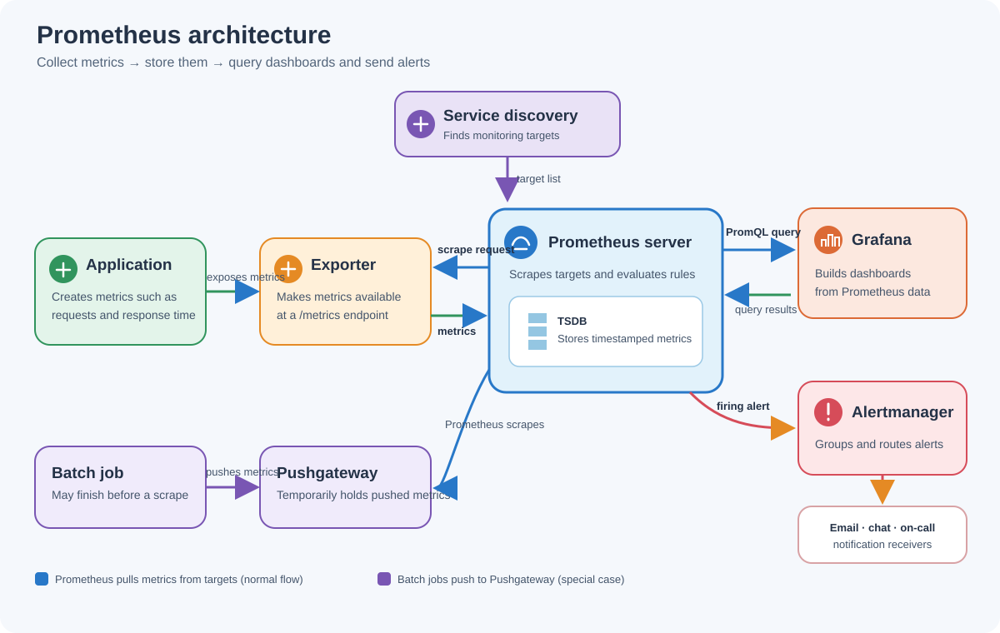

# Prometheus Overview and Architecture

Prometheus is an open-source monitoring system that collects and stores metrics as time series. It generally uses a **pull model**: the Prometheus server discovers targets and periodically scrapes their HTTP metrics endpoints.

## Core components

| Component | What it does |
| :--- | :--- |
| **Prometheus server** | Finds targets, collects their metrics, stores them, and answers queries. |
| **Exporters** | Make metrics available for systems that do not expose them in Prometheus format. For example, node_exporter provides host metrics. Applications can also expose metrics directly. |
| **Pushgateway** | Holds metrics sent by short-lived batch jobs so Prometheus can scrape them later. It is a special case, not a replacement for normal scraping. |
| **Alertmanager** | Receives alerts from Prometheus, groups and deduplicates them, and routes notifications. |
| **Service discovery** | Finds scrape targets, such as services running in Kubernetes, so Prometheus can monitor them as they change. |
| **PromQL** | The query language used to explore and calculate metrics, build dashboards, and define alerting or recording rules. |
| **Time Series Database (TSDB)** | Prometheus's built-in database, which stores timestamped metric values along with labels such as the target name. |

## Architecture and data flow

**In one sentence:** Prometheus collects metrics from applications and exporters, stores them, and makes them available for dashboards and alerts.

### What happens during a scrape?

1. Service discovery or static configuration supplies Prometheus with target endpoints and labels.
2. At each configured scrape interval, Prometheus makes an HTTP request to a target's metrics endpoint, commonly `/metrics`.
3. Prometheus parses the returned samples and writes them to its TSDB with timestamps and labels.
4. PromQL queries, dashboards, and recording or alerting rules can then use the stored time series.
5. When an alerting rule fires, Prometheus sends the alert to Alertmanager, which handles notification routing and delivery.

Grafana queries Prometheus through its HTTP API to visualize metrics; it is not part of the scraping or storage path. Prometheus can also be queried directly through its own expression browser and API.

## Pull-based monitoring and Pushgateway

In the normal flow, Prometheus initiates connections to scrape targets. This makes target health and scrape failures visible to Prometheus and keeps collection configuration on the server side.

Short-lived batch jobs may finish before a regular scrape can collect their metrics. Such a job can push metrics to Pushgateway; Prometheus then scrapes the gateway. Because pushed metrics can remain there after a job has finished, configure lifecycle and grouping-key behavior carefully to avoid stale or misleading metrics.

## Key terms

| Term | Meaning |
| :--- | :--- |
| **Target** | An endpoint Prometheus scrapes for metrics. |
| **Scrape** | An HTTP request Prometheus makes to collect a target's current metrics. |
| **Time series** | A sequence of timestamped samples for a metric name and label set. |
| **Label** | A key-value dimension attached to a metric, such as `job` or `instance`. |
| **Rule** | A Prometheus expression evaluated periodically to create a recording series or an alert. |
