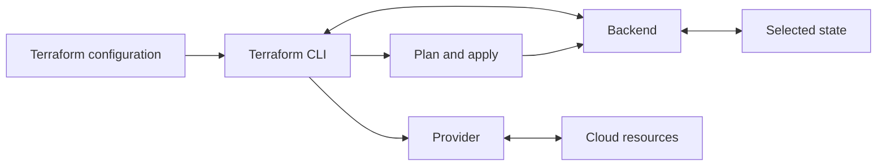

# Terraform Backends & State Management

Terraform **state** records the relationship between resource addresses in configuration and real infrastructure. A **backend** determines where that state is stored and how Terraform performs operations that use it.

The backend is not the same as a provider: providers create, read, update, and delete infrastructure; a backend stores and coordinates access to Terraform state.

## How backend and state fit into the workflow



During a plan or apply, Terraform loads the selected state, consults providers about real resources, calculates changes, and writes state updates through the backend. A backend may also provide state locking or remote execution, depending on its implementation.

## Local and remote backends

- **Local backend:** The default. Stores state in a local `terraform.tfstate` file. Suitable for experiments, but sharing copies of this file between teammates is error-prone.
- **Remote backend:** Stores state in a shared service or object store. Depending on the backend, it may support access controls, encryption, version history, locking, and team workflows.

Common choices include AWS S3, Azure Blob Storage (`azurerm` backend), Google Cloud Storage, and HCP Terraform. Choose a backend that your team can secure, back up, and access reliably.

### Example: AWS S3 backend

An S3 backend can be configured in a `terraform` block:

```hcl
terraform {
  backend "s3" {
    bucket       = "REPLACE_WITH_PRIVATE_STATE_BUCKET"
    key          = "network/terraform.tfstate"
    region       = "us-west-2"
    encrypt      = true
    use_lockfile = true
  }
}
```

The bucket must already exist, be private, and be protected with appropriate access controls. Enable bucket versioning to help recover previous state versions. This example uses S3's native state locking; use Terraform 1.10 or later. Authenticate through the AWS credential chain rather than putting access keys in the backend block.

Backend blocks are configured during `terraform init`. They cannot use normal Terraform variables, locals, or data-source references. Keep credentials out of backend configuration and command-line arguments; backend settings can be cached in local Terraform metadata and saved plan files.

## Initialize or change a backend

For a new working directory or a new backend configuration, run:

```bash
terraform init
```

When moving existing state to a different backend, back up state according to the current backend's recovery process, configure the destination, and migrate with:

```bash
terraform init -migrate-state
```

Review Terraform's prompts and confirm that the state is being copied to the intended destination. `-reconfigure` is different: it tells Terraform to use the new backend configuration without migrating the previously configured state. Do not use it as a substitute for state migration.

After initialization, check the selected workspace and run a plan before applying:

```bash
terraform workspace show
terraform plan
```

## Locking and concurrent operations

Backends that support state locking use a lock to prevent concurrent Terraform operations from modifying the same state at once. Locking does not prevent manual changes in a cloud console or changes made by another tool.

Use the backend's locking support for shared state. Do not disable locking to work around an active lock without investigating it. `terraform force-unlock` is an exceptional recovery action: use it only when you have verified that the operation holding the lock is no longer running, and use the exact lock ID Terraform reports.

## Protect and recover state

State may contain passwords, tokens, private keys, provider-returned values, and output values. Treat state and saved plans as sensitive:

- Restrict read and write access to the state backend.
- Use the backend's supported encryption and enable state versioning or backups where available.
- Do not commit `.tfstate` files, state backups, saved plans, or credentials.
- Marking a variable or output `sensitive` hides some CLI display but does not remove its value from state.
- Do not edit state JSON manually. Use Terraform commands and review the plan afterward.

Remote state is still sensitive data; moving it out of a local file does not make it safe to expose.

## Inspect and update state safely

These commands operate on the currently selected state's resources:

```bash
terraform state list
terraform state show aws_instance.web
```

Terraform also provides commands for controlled state changes:

- `terraform import` or an `import` block associates an existing object with a declared resource.
- `terraform state mv` changes a resource's address in state, for example when refactoring configuration.
- `terraform state rm` removes a resource mapping from state but does **not** delete the real object.

Before a state change, confirm the selected workspace, understand the command's effect, and ensure the backend has a recoverable backup. Review a new plan afterward. Avoid `terraform state pull` unless necessary: it prints the full state and may expose secrets in terminal history or logs.

## Backends and workspaces

Terraform CLI workspaces usually represent separate state instances managed by the same configuration. A backend controls where and how those workspace states are stored; support and storage layout differ by backend. Workspaces do not automatically provide separate credentials, access controls, or environments. Use separate configurations, accounts, or backends when you need stronger operational separation.

HCP Terraform also provides hosted workspaces and run features. These are distinct from the Terraform CLI workspace command; see [Terraform Cloud (HCP Terraform)](./terraform-cloud.md) and [Terraform Workspaces](./terraform-workspaces.md).

## Key takeaways

- The backend stores state; the provider manages infrastructure.
- Use a secure remote backend with locking and recovery support for team-managed state.
- Migrate existing state with `terraform init -migrate-state`; `-reconfigure` does not migrate it.
- Protect state and plans as sensitive data, and never edit state files directly.
- State commands change Terraform's tracking, not necessarily the real infrastructure.
