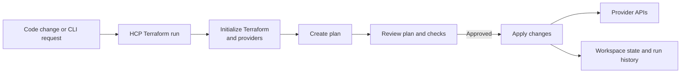

# Terraform Cloud (HCP Terraform)

**HCP Terraform**, previously called **Terraform Cloud**, is HashiCorp's hosted service for collaborating on Terraform infrastructure. It provides a shared place to connect configuration, manage state, run plans and applies, control access, and review run history.

Terraform remains the tool that interprets HCL and works with providers. HCP Terraform coordinates Terraform runs and shared workflows; it is not itself a cloud provider and does not replace provider plugins.

## Main concepts

- **Organization:** A top-level account that groups teams, workspaces, and shared settings.
- **HCP Terraform workspace:** A remote unit associated with a configuration, variables, state, run history, and permissions.
- **Run:** A Terraform plan and, when approved, apply. A run can be triggered from a connected version-control system or the Terraform CLI.
- **Execution mode:** Determines where Terraform runs, such as in HCP Terraform's hosted environment or through a configured agent.

The exact capabilities available depend on the HCP Terraform plan and configuration.

## How a run works



In a common workflow, a developer pushes a change to a connected repository. HCP Terraform starts a run for the associated workspace, initializes Terraform and the required providers, and creates a plan. Teammates can inspect the plan and any configured checks before an apply is approved. The resulting state and run details are available to authorized users.

Teams can also start runs from the CLI. Regardless of how a run is triggered, review proposed changes and ensure the workspace is associated with the intended configuration, credentials, and infrastructure.

## Connect a Terraform configuration

The `cloud` block connects a root configuration to an organization and a named HCP Terraform workspace:

```hcl
terraform {
  cloud {
    organization = "example-org"

    workspaces {
      name = "network-production"
    }
  }
}
```

This block identifies the remote workspace; it does not declare infrastructure resources or provider credentials. Follow the service's setup flow to authenticate and initialize the working directory. Runs use the execution mode configured for that workspace. Configure either the `cloud` integration or a backend as appropriate; do not configure both in the same root module.

Alternatively, a workspace can connect to a version-control repository so changes trigger runs. Teams can configure workspace variables, variable sets, access permissions, and other run settings in the service. Keep secrets in an approved secrets or identity workflow rather than committing them to Terraform files.

## Why teams use HCP Terraform

- **Shared state:** Teams and automation use a common remote state rather than copying local state files.
- **Collaboration:** Plans, approvals, run logs, and history are visible to permitted users.
- **Automation:** Version-control integration can connect code changes to plans and applies.
- **Access management:** Organizations can assign permissions to teams and workspaces.
- **Governance:** Depending on the plan and setup, runs can use policy checks, cost estimates, or other controls.

HCP Terraform also supports private module and provider registries in configurations where those features are available.

## HCP Terraform workspaces vs. CLI workspaces

These are different concepts:

| HCP Terraform workspace | Terraform CLI workspace |
| :--- | :--- |
| Hosted unit for configuration connection, variables, state, runs, and permissions | Selects a separate state instance for the same local configuration and backend |
| Can be associated with a repository and run settings | Does not provide a VCS workflow or workspace-level access controls by itself |
| Managed through the HCP Terraform service and supported CLI integration | Managed with commands such as `terraform workspace list` and `terraform workspace select` |

Use the term **HCP Terraform workspace** when referring to the hosted service's unit. See [Terraform Workspaces](./terraform-workspaces.md) for the CLI feature.

## Security and operational practices

- Grant users, teams, and automation only the permissions they need.
- Use securely managed credentials or dynamic identity where supported; avoid hardcoding cloud keys.
- Treat state and run output as sensitive because they may contain sensitive values.
- Review plans and configured policy checks before approving applies.
- Keep provider version constraints and `.terraform.lock.hcl` under review in version control.
- Choose execution mode and agent placement based on network access and organizational requirements.

## Key takeaways

- HCP Terraform (formerly Terraform Cloud) hosts collaboration and run workflows for Terraform.
- A service workspace brings together configuration, variables, state, permissions, and run history.
- Runs can be triggered through version-control integration or the CLI and may execute in hosted or agent environments.
- HCP Terraform workspaces are not the same as Terraform CLI workspaces.
- Configure permissions, credentials, state protection, and approvals deliberately.
