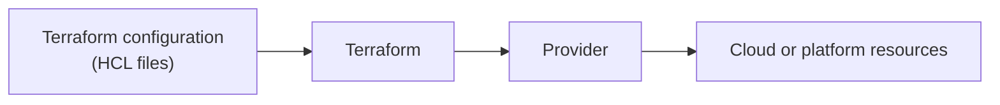
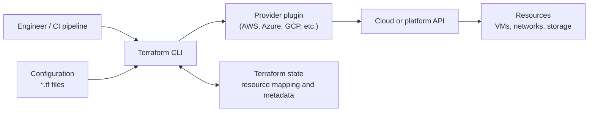
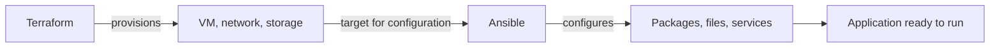
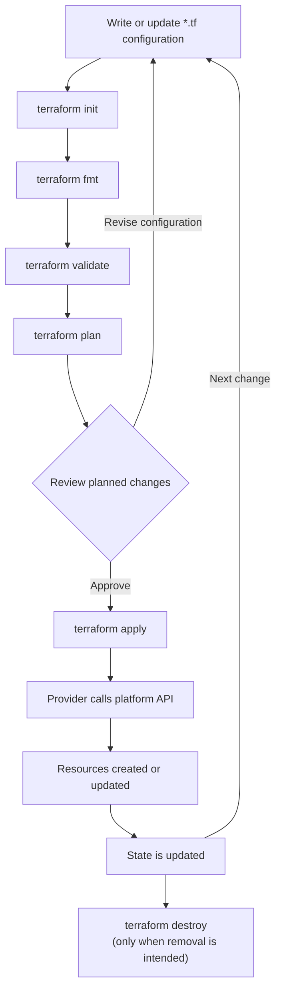

# Terraform: Introduction, Architecture & Workflow

This guide introduces Terraform, shows how its main components fit together, and walks through the typical workflow for provisioning infrastructure.

---

<details>
<summary><strong>1. What is Terraform?</strong></summary>

<br>

Terraform is an infrastructure provisioning and lifecycle management tool created by HashiCorp. It lets you describe resources—such as virtual machines, networks, and databases—in configuration files written in **HashiCorp Configuration Language (HCL)**.

Terraform is **declarative**: you specify the desired resources, and Terraform works out the changes needed to create or update them through the relevant provider.



Terraform supports providers for many cloud platforms and other services, so it can manage resources through a consistent workflow.

</details>

---

<details>
<summary><strong>2. What can Terraform manage?</strong></summary>

<br>

Terraform manages resources through **providers**. A provider is a plugin that allows Terraform to work with a platform or service API. A configuration can use providers to manage resources such as:

- Compute, networks, and storage
- Managed databases and other platform resources
- Resources exposed by supported services and APIs

Terraform can manage resources across different providers with the same core workflow. The exact resources and settings available depend on each provider.

</details>

---

<details>
<summary><strong>3. Terraform architecture: what are the main components?</strong></summary>

<br>



- **Configuration:** `.tf` files describe providers, resources, inputs, and outputs.
- **Terraform CLI:** reads configuration, compares it with state and remote objects, and coordinates operations.
- **Provider:** a plugin that translates Terraform operations into calls to a platform's API.
- **Resources:** the infrastructure objects managed by Terraform.
- **State:** records Terraform's mapping between configuration and real resources. State can contain sensitive data, so protect access and use an appropriate remote backend for team use.
- **Credentials:** allow the provider to authenticate to the target platform. Use a securely managed identity with only the permissions required; avoid hardcoding credentials in configuration.

### Terraform and Ansible have different primary roles

Terraform is primarily used to **provision and manage infrastructure resources**. Ansible is commonly used to **configure operating systems and software on existing servers**.



They can be used together, but Terraform does not need to run Ansible in order to provision infrastructure. For configuration management, teams typically connect the tools in their automation pipeline.

</details>

---

<details>
<summary><strong>4. Terraform workflow: init, validate, plan, apply</strong></summary>

<br>



| Command | Purpose |
| :--- | :--- |
| `terraform init` | Initializes the working directory, configures the backend, and installs required provider plugins. |
| `terraform fmt` | Formats Terraform configuration consistently. |
| `terraform validate` | Checks configuration syntax and internal consistency. |
| `terraform plan` | Previews the actions Terraform proposes; it does not apply those changes. |
| `terraform apply` | Applies the planned changes after confirmation, unless approval behavior is configured otherwise. |
| `terraform destroy` | Plans and applies removal of resources managed by the configuration and state. Review carefully before confirming. |

Terraform can update state during operations. In team environments, use a shared remote backend with locking where supported rather than sharing a local state file.

</details>

---

<details>
<summary><strong>5. Examples: describe resources on AWS, Azure, and Google Cloud</strong></summary>

<br>

These examples show a virtual machine resource for each cloud provider. They assume the corresponding provider is configured and credentials are available securely. Replace placeholder values with ones valid for your account and region.

```hcl
# AWS
resource "aws_instance" "web" {
  ami           = "ami-REPLACE_WITH_VALID_IMAGE_ID"
  instance_type = "t3.micro"

  tags = {
    Name = "web-server"
  }
}
```

```hcl
# Azure
resource "azurerm_linux_virtual_machine" "web" {
  name                = "web-server"
  resource_group_name = "REPLACE_WITH_RESOURCE_GROUP"
  location            = "REPLACE_WITH_AZURE_REGION"
  size                = "Standard_B1s"
  admin_username      = "azureuser"

  network_interface_ids = [
    azurerm_network_interface.web.id
  ]

  admin_ssh_key {
    username   = "azureuser"
    public_key = file("~/.ssh/id_rsa.pub")
  }

  os_disk {
    caching              = "ReadWrite"
    storage_account_type = "Standard_LRS"
  }

  source_image_reference {
    publisher = "Canonical"
    offer     = "0001-com-ubuntu-server-jammy"
    sku       = "22_04-lts"
    version   = "latest"
  }
}
```

The Azure example expects the referenced resource group and network interface to be defined elsewhere in the configuration.

```hcl
# Google Cloud
resource "google_compute_instance" "web" {
  name         = "web-server"
  machine_type = "e2-micro"
  zone         = "REPLACE_WITH_GCP_ZONE"

  boot_disk {
    initialize_params {
      image = "debian-cloud/debian-12"
    }
  }

  network_interface {
    network = "default"
  }
}
```

</details>

---

<details>
<summary><strong>6. IaC tools at a glance</strong></summary>

<br>

| Tool | Typical focus |
| :--- | :--- |
| **Terraform** | Provisioning and lifecycle management across many cloud and service providers |
| **AWS CloudFormation** | Provisioning AWS resources |
| **Azure Resource Manager (ARM)** | Provisioning Azure resources |
| **Google Cloud Deployment Manager** | Google Cloud infrastructure templates |
| **Ansible, Chef, Puppet** | Configuration management and automation on systems |

Tool capabilities can overlap. Choose based on your platform, team workflow, and the type of resources or configuration you need to manage.

</details>

---

<details>
<summary><strong>Key takeaways</strong></summary>

<br>

- Terraform lets you describe desired infrastructure as code using HCL.
- Providers connect Terraform to cloud and service APIs.
- `terraform plan` previews proposed changes; `terraform apply` makes them.
- State tracks Terraform's relationship to managed resources and must be protected.
- Terraform commonly provisions infrastructure; Ansible commonly configures software on servers.
- Review plans and use securely managed credentials before applying changes.

</details>
