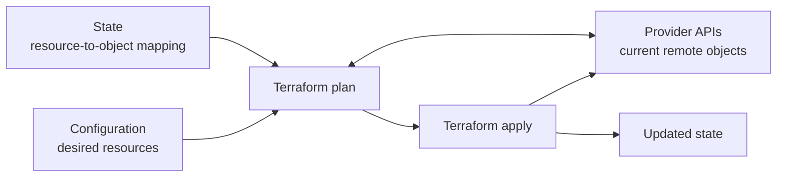

# Terraform State

Terraform state is the record Terraform uses to connect objects declared in configuration to the real infrastructure managed through providers. It helps Terraform identify which remote object corresponds to a resource address such as `aws_instance.web`, and stores information needed to plan and manage that resource.

State is essential to Terraform's workflow, but it is not the desired configuration itself and is not a complete, always-current inventory of every object in a cloud account.

## How Terraform uses state

Terraform uses configuration to describe the desired resources, state to map those resources to remote objects, and provider APIs to inspect or change those objects.



In a typical workflow:

1. Terraform loads the configuration and the selected state's resource mappings.
2. During planning, providers may read remote objects to refresh Terraform's view of them.
3. Terraform compares the configuration with the refreshed state and proposes changes.
4. After an apply succeeds, Terraform records the resulting resource information in state.

State also stores resource attributes, dependency information, and root-module output values. Some of these values may be sensitive, even when the corresponding variable or output is marked `sensitive`.

## Why state matters

- **Resource identity:** Maps Terraform addresses to the remote objects Terraform manages.
- **Efficient planning:** Helps Terraform determine what to inspect and what changes may be needed.
- **Dependency and attribute data:** Retains information Terraform uses to order operations and evaluate references.
- **Outputs:** Stores root-module output values that can be queried later.

Terraform can manage an existing object only when it has a state mapping for it (for example, after importing it) and the configuration declares how it should be managed. Creating a resource outside Terraform does not automatically add it to a state's mappings.

## Local and remote state

By default, Terraform uses the **local backend**, which stores state in a local `terraform.tfstate` file. This can work for individual experiments, but a local file is easy to lose, copy inconsistently, or expose accidentally.

For team use, configure a **remote backend** that is appropriate for the organization. A remote backend can provide centralized storage and, depending on the backend, access controls, encryption, version history, and state locking. These capabilities are backend-specific and should be configured and verified rather than assumed.

State may contain passwords, tokens, private keys, or other sensitive values returned by providers. Protect it as sensitive data:

- Restrict who and what can read or change the state.
- Use the backend's supported encryption and access-control mechanisms.
- Do not commit state files or state backups to source control.
- Do not assume `sensitive = true` removes a value from state; it primarily affects display in CLI output.

## State locking and concurrent operations

When a backend supports locking, Terraform uses a lock to help prevent multiple operations from changing the same state at the same time. Use a backend with locking for shared state and avoid disabling locking in normal workflows. A lock coordinates access to state; it does not prevent changes made directly through a cloud console or another tool.

## Useful state commands

Use the supported Terraform commands to inspect state rather than editing the file directly:

```bash
# List resource addresses tracked in the selected state
terraform state list

# Inspect one tracked resource
terraform state show aws_instance.web
```

`terraform state show` can display sensitive attributes. Treat terminal output, logs, and captured command output accordingly. The `terraform state pull` command prints the entire state in a readable form and should only be used where that data can be handled securely.

State-changing commands such as moving or removing a resource from state can affect what Terraform plans next. Understand the command's effect, select the intended workspace, and ensure the state is backed up according to your backend's recovery process before making a state change. Removing a resource from state does not delete the real object; it makes Terraform stop tracking it in that state.

## Drift and importing existing resources

**Drift** is a difference between the configuration/state and the real infrastructure, often caused by changes made outside Terraform. A plan refreshes information from providers and can reveal changes. Review the proposed actions carefully: Terraform may update, replace, or remove objects to bring them back in line with configuration.

To bring an existing supported object under Terraform management, declare its resource in configuration and use Terraform's import workflow to associate it with the appropriate resource address. Importing updates state; it does not automatically write a complete configuration or guarantee that the declared settings match the object's current settings. Review and plan after importing.

## Key takeaways

- State maps Terraform resource addresses to remote objects and stores information Terraform needs to manage them.
- Configuration describes the desired setup; state is not a replacement for configuration or a complete cloud inventory.
- State can contain sensitive data. Protect it, avoid committing it, and do not edit the file manually.
- Remote backends and locking help teams share state safely, but exact features depend on the backend.
- Review plans after drift or state changes; removing a state entry does not delete the real infrastructure.

For backend setup, state migration, locking, and state operations, see [Terraform Backends & State Management](./terraform-backends-state-management.md).
