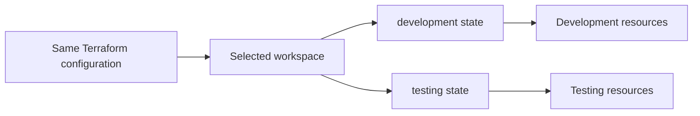

# Terraform Workspaces

Terraform workspaces let one configuration and backend keep multiple, separate state instances. They are useful when you want to manage several similar deployments from the same Terraform code, such as short-lived test environments.

## What is a workspace?

Terraform compares the configuration with state to determine which resources it manages. Each workspace has its own state, so the same configuration can be used to manage different instances without mixing their Terraform resource records.



The `default` workspace exists automatically. It is selected initially and cannot be deleted. Other workspaces must be created and selected explicitly.

## Workspace commands

Run these commands from the Terraform working directory:

```bash
# Show all workspaces; * marks the current one
terraform workspace list

# Show the current workspace
terraform workspace show

# Create and switch to a new workspace
terraform workspace new testing

# Switch to an existing workspace
terraform workspace select default
```

Creating or selecting a workspace changes which state Terraform uses; it does not automatically create, update, or destroy infrastructure. As usual, review the plan before applying:

```bash
terraform plan
terraform apply
```

For backends that support workspaces, Terraform keeps workspace states separately using a backend-specific mechanism. With the local backend, non-default workspace state is stored under `terraform.tfstate.d/<workspace-name>/`. State may contain sensitive values, so protect access to the backend and its stored data.

## Using the workspace name in configuration

The `terraform.workspace` expression returns the name of the currently selected workspace. It can be used to distinguish resource names or settings:

```hcl
resource "aws_s3_bucket" "logs" {
  bucket = "example-app-${terraform.workspace}-logs"

  tags = {
    Environment = terraform.workspace
  }
}
```

Ensure generated names meet the target provider's naming rules and are unique. Workspace names should not be treated as a security boundary or as a substitute for validating configuration values.

## When workspaces are a good fit

Workspaces can be useful when environments:

- Use the same configuration and provider setup.
- Have similar lifecycle and access-control requirements.
- Need separate state while sharing a common codebase.

For example, separate workspaces can represent temporary preview deployments. Use environment-specific variable files or other explicit inputs for differing settings, and inspect the selected workspace before running an apply.

## Limitations and alternatives

Workspaces isolate Terraform state, not the rest of the environment. They do not provide separate access controls, credentials, provider configuration, or configuration code. A workspace also does not prevent two states from managing the same real-world resource if the configuration is arranged to do so.

Use separate root configurations and appropriately isolated backends/accounts when environments need independent permissions, different provider setups, or stronger operational separation—especially for production. This makes the boundary more visible and easier to review.

Terraform CLI workspaces are also distinct from **HCP Terraform workspaces**. HCP Terraform workspaces are remote units for configuration, variables, runs, and state; the CLI workspace feature described here primarily selects a state instance for the current configuration.

## Removing a workspace

Switch away from a workspace before deleting it:

```bash
terraform workspace select default
terraform workspace delete testing
```

Terraform normally prevents deletion of a workspace whose state tracks resources. Do not bypass that protection casually: deleting a workspace removes its state, not the real infrastructure, and can leave resources unmanaged. Destroy resources intentionally with the correct workspace selected before deleting its state.

## Key takeaways

- A workspace is a separately selected Terraform state instance for a configuration.
- `terraform workspace new` creates and selects a workspace; `select` changes the active workspace.
- Selecting a workspace does not itself change infrastructure; `plan` and `apply` still control changes.
- Workspaces separate state, not credentials, permissions, providers, or configuration.
- Prefer separate configurations and stronger environment boundaries when lifecycle or access requirements differ.
