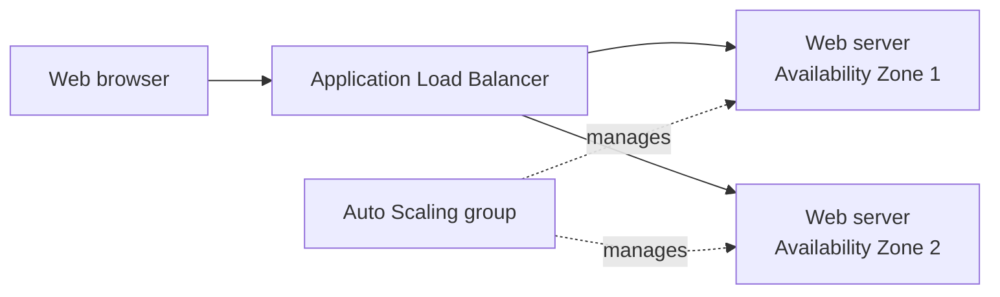

# Lab 05: Deploy a Highly Available Web Application

In this end-to-end lab, Terraform creates a small AWS web tier across two Availability Zones. An internet-facing Application Load Balancer routes HTTP traffic to web servers managed by an Auto Scaling group.



> **Cost and security warning:** This lab creates an Application Load Balancer, EC2 instances, public IPv4 addresses, and related networking resources. These may incur charges. The site uses unencrypted HTTP, and the servers use public subnets so they can install packages at startup; their security group permits web traffic only from the load balancer. This is a learning example, not a production design. Apply only if you understand the costs, and destroy everything when finished.

## Prerequisites

- Terraform CLI, AWS CLI, and an AWS account with permission to manage VPC networking, security groups, load balancers, launch templates, Auto Scaling groups, and EC2 instances.
- A working AWS CLI profile; see [AWS Authentication & Provider](./lab01-aws-authentication.md).
- Quota for at least two EC2 instances and an Application Load Balancer in the chosen region.

## 1. Select the AWS account and create a working directory

Use a separate directory so this lab has its own Terraform state:

```bash
mkdir -p ~/terraform-aws-web-app
cd ~/terraform-aws-web-app
export AWS_PROFILE=terraform-lab
aws sts get-caller-identity
```

Confirm that the account is the one where you intend to create resources. The configuration defaults to `us-west-2` and `t3.micro`; choose a region and instance type available to your account.

## 2. Create `main.tf`

Create a file named `main.tf` in the working directory:

```hcl
terraform {
  required_version = ">= 1.5.0"

  required_providers {
    aws = {
      source  = "hashicorp/aws"
      version = "~> 5.0"
    }
  }
}

variable "aws_region" {
  description = "AWS region for the web application."
  type        = string
  default     = "us-west-2"
}

variable "instance_type" {
  description = "EC2 instance type used by the web tier."
  type        = string
  default     = "t3.micro"
}

provider "aws" {
  region = var.aws_region
}

data "aws_availability_zones" "available" {
  state = "available"
}

data "aws_ami" "amazon_linux" {
  most_recent = true
  owners      = ["amazon"]

  filter {
    name   = "name"
    values = ["al2023-ami-2023.*-x86_64"]
  }

  filter {
    name   = "architecture"
    values = ["x86_64"]
  }

  filter {
    name   = "virtualization-type"
    values = ["hvm"]
  }
}

locals {
  availability_zones = slice(data.aws_availability_zones.available.names, 0, 2)
  public_subnet_cidrs = [
    "10.0.1.0/24",
    "10.0.2.0/24",
  ]
}

resource "aws_vpc" "web" {
  cidr_block           = "10.0.0.0/16"
  enable_dns_support   = true
  enable_dns_hostnames = true

  tags = {
    Name = "terraform-web-app-vpc"
  }
}

resource "aws_internet_gateway" "web" {
  vpc_id = aws_vpc.web.id

  tags = {
    Name = "terraform-web-app-igw"
  }
}

resource "aws_subnet" "public" {
  count                   = 2
  vpc_id                  = aws_vpc.web.id
  availability_zone       = local.availability_zones[count.index]
  cidr_block              = local.public_subnet_cidrs[count.index]
  map_public_ip_on_launch = true

  tags = {
    Name = "terraform-web-public-${count.index + 1}"
  }
}

resource "aws_route_table" "public" {
  vpc_id = aws_vpc.web.id

  route {
    cidr_block = "0.0.0.0/0"
    gateway_id = aws_internet_gateway.web.id
  }

  tags = {
    Name = "terraform-web-public"
  }
}

resource "aws_route_table_association" "public" {
  count          = 2
  subnet_id      = aws_subnet.public[count.index].id
  route_table_id = aws_route_table.public.id
}

resource "aws_security_group" "load_balancer" {
  name        = "terraform-web-alb"
  description = "Allow public HTTP traffic to the load balancer."
  vpc_id      = aws_vpc.web.id

  ingress {
    description = "HTTP from the internet"
    from_port   = 80
    to_port     = 80
    protocol    = "tcp"
    cidr_blocks = ["0.0.0.0/0"]
  }

  egress {
    from_port   = 0
    to_port     = 0
    protocol    = "-1"
    cidr_blocks = ["0.0.0.0/0"]
  }
}

resource "aws_security_group" "web" {
  name        = "terraform-web-servers"
  description = "Allow HTTP only from the load balancer."
  vpc_id      = aws_vpc.web.id

  ingress {
    description     = "HTTP from the load balancer"
    from_port       = 80
    to_port         = 80
    protocol        = "tcp"
    security_groups = [aws_security_group.load_balancer.id]
  }

  egress {
    from_port   = 0
    to_port     = 0
    protocol    = "-1"
    cidr_blocks = ["0.0.0.0/0"]
  }
}

resource "aws_lb" "web" {
  name               = "terraform-web-app"
  internal           = false
  load_balancer_type = "application"
  subnets            = aws_subnet.public[*].id
  security_groups    = [aws_security_group.load_balancer.id]
}

resource "aws_lb_target_group" "web" {
  name     = "terraform-web-targets"
  port     = 80
  protocol = "HTTP"
  vpc_id   = aws_vpc.web.id

  health_check {
    path                = "/"
    matcher             = "200"
    healthy_threshold   = 2
    unhealthy_threshold = 2
    interval            = 30
    timeout             = 5
  }
}

resource "aws_lb_listener" "http" {
  load_balancer_arn = aws_lb.web.arn
  port              = 80
  protocol          = "HTTP"

  default_action {
    type             = "forward"
    target_group_arn = aws_lb_target_group.web.arn
  }
}

resource "aws_launch_template" "web" {
  name_prefix            = "terraform-web-"
  image_id               = data.aws_ami.amazon_linux.id
  instance_type          = var.instance_type
  vpc_security_group_ids = [aws_security_group.web.id]

  user_data = base64encode(<<-USERDATA
    #!/bin/bash
    dnf install -y nginx
    systemctl enable --now nginx
    echo "<h1>Terraform web application</h1><p>Server: $(hostname)</p>" > /usr/share/nginx/html/index.html
    USERDATA
  )

  tag_specifications {
    resource_type = "instance"

    tags = {
      Name = "terraform-web-server"
    }
  }
}

resource "aws_autoscaling_group" "web" {
  name                = "terraform-web-app"
  min_size            = 2
  desired_capacity    = 2
  max_size            = 4
  vpc_zone_identifier = aws_subnet.public[*].id
  target_group_arns   = [aws_lb_target_group.web.arn]
  health_check_type   = "ELB"

  launch_template {
    id      = aws_launch_template.web.id
    version = "$Latest"
  }
}

resource "aws_autoscaling_policy" "web_cpu" {
  name                   = "terraform-web-cpu-target"
  policy_type            = "TargetTrackingScaling"
  autoscaling_group_name = aws_autoscaling_group.web.name

  target_tracking_configuration {
    predefined_metric_specification {
      predefined_metric_type = "ASGAverageCPUUtilization"
    }

    target_value = 50
  }
}

output "website_url" {
  description = "HTTP URL for the load-balanced web application."
  value       = "http://${aws_lb.web.dns_name}"
}

output "autoscaling_group_name" {
  description = "Name of the web server Auto Scaling group."
  value       = aws_autoscaling_group.web.name
}
```

The Auto Scaling group starts with two servers and can add servers up to four when average CPU exceeds its target. The launch template installs Nginx on each server. The load balancer accepts public HTTP traffic, while the web-server security group accepts HTTP only from the load balancer.

## 3. Initialize and review the plan

```bash
terraform init
terraform fmt -check
terraform validate
terraform plan
```

Review the resources, region, instance type, and estimated costs. The plan should include a VPC, two subnets, routing, security groups, a load balancer, a launch template, and an Auto Scaling group. Nothing is created until you apply.

## 4. Deploy and test

Apply only after you have reviewed and approved the plan:

```bash
terraform apply
```

After the apply completes, get the website address:

```bash
terraform output -raw website_url
```

Open the URL in a browser or request it with `curl`:

```bash
curl "$(terraform output -raw website_url)"
```

It may take a few minutes for the instances to install Nginx and pass the load balancer health check.

## 5. Clean up

When finished, destroy the resources from the same directory and state:

```bash
terraform destroy
```

Review the destroy plan and confirm. This removes the load balancer, servers, and networking resources managed by this configuration.
