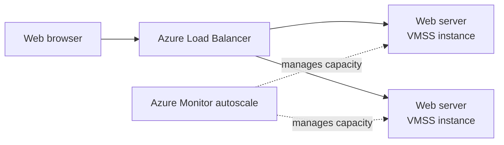

# Lab 05: Deploy a Highly Available Web Application

In this end-to-end lab, Terraform creates a small Azure web tier. A public Azure Load Balancer routes HTTP traffic to Ubuntu servers in a Virtual Machine Scale Set (VMSS). Azure Monitor autoscaling can add instances when CPU use rises.



> **Cost and security warning:** This lab creates a VM Scale Set, a Standard public Load Balancer, a public IP address, and networking resources. These may incur charges, including outbound data transfer. HTTP is unencrypted. The VM instances have no public IPs, and the network security group permits HTTP only. A local admin password is stored in Terraform state; keep the working directory private and never commit state files. This is a learning example, not a production design. Destroy the resources when finished.

## Prerequisites

- Terraform CLI, Azure CLI, and an Azure subscription with permission to manage resource groups, networks, load balancers, VM Scale Sets, and autoscale settings.
- A signed-in Azure CLI account and selected subscription; see [Azure Authentication & Provider](./lab01-azure-authentication.md).
- Quota for at least two VM instances and a Standard Load Balancer in the chosen region.

## 1. Select the subscription and create a working directory

Use a separate directory so this lab has its own Terraform state:

```bash
mkdir -p ~/terraform-azure-web-app
cd ~/terraform-azure-web-app
az account show --output table
export TF_VAR_subscription_id="$(az account show --query id --output tsv)"
printf "Enter a strong VM admin password: "
read -s TF_VAR_admin_password
printf '\n'
export TF_VAR_admin_password
```

Confirm that the selected subscription is the one where you intend to create resources. The configuration defaults to `eastus` and `Standard_B1s`; select values available to your subscription.

## 2. Create the startup script

Create `cloud-init.yaml` in the working directory. Cloud-init installs Nginx when each VM Scale Set instance starts:

```yaml
#cloud-config
package_update: true
packages:
  - nginx
write_files:
  - path: /var/www/html/index.html
    permissions: "0644"
    content: |
      <!doctype html>
      <html><body><h1>Azure Terraform web app</h1>
      <p>Served by a VM Scale Set instance.</p></body></html>
runcmd:
  - [systemctl, enable, --now, nginx]
```

## 3. Create `main.tf`

Create a file named `main.tf` in the same directory:

```hcl
terraform {
  required_version = ">= 1.5.0"

  required_providers {
    azurerm = {
      source  = "hashicorp/azurerm"
      version = "~> 4.0"
    }
  }
}

variable "subscription_id" {
  description = "Azure subscription for this deployment."
  type        = string
}

variable "location" {
  description = "Azure region for the web application."
  type        = string
  default     = "eastus"
}

variable "vm_size" {
  description = "VM size available in the selected region."
  type        = string
  default     = "Standard_B1s"
}

variable "admin_password" {
  description = "Local administrator password for the VM Scale Set."
  type        = string
  sensitive   = true
}

provider "azurerm" {
  features {}

  subscription_id = var.subscription_id
}

resource "azurerm_resource_group" "web" {
  name     = "rg-terraform-web-app"
  location = var.location
}

resource "azurerm_virtual_network" "web" {
  name                = "vnet-terraform-web-app"
  address_space       = ["10.40.0.0/16"]
  location            = azurerm_resource_group.web.location
  resource_group_name = azurerm_resource_group.web.name
}

resource "azurerm_subnet" "web" {
  name                 = "web"
  resource_group_name  = azurerm_resource_group.web.name
  virtual_network_name = azurerm_virtual_network.web.name
  address_prefixes     = ["10.40.1.0/24"]
}

resource "azurerm_network_security_group" "web" {
  name                = "nsg-terraform-web-app"
  location            = azurerm_resource_group.web.location
  resource_group_name = azurerm_resource_group.web.name

  security_rule {
    name                       = "AllowHttpFromInternet"
    priority                   = 100
    direction                  = "Inbound"
    access                     = "Allow"
    protocol                   = "Tcp"
    source_port_range          = "*"
    source_address_prefix      = "Internet"
    destination_port_range     = "80"
    destination_address_prefix = "*"
  }

  security_rule {
    name                       = "AllowHttpHealthProbes"
    priority                   = 110
    direction                  = "Inbound"
    access                     = "Allow"
    protocol                   = "Tcp"
    source_port_range          = "*"
    source_address_prefix      = "AzureLoadBalancer"
    destination_port_range     = "80"
    destination_address_prefix = "*"
  }
}

resource "azurerm_subnet_network_security_group_association" "web" {
  subnet_id                 = azurerm_subnet.web.id
  network_security_group_id = azurerm_network_security_group.web.id
}

resource "azurerm_public_ip" "web" {
  name                = "pip-terraform-web-app"
  location            = azurerm_resource_group.web.location
  resource_group_name = azurerm_resource_group.web.name
  allocation_method   = "Static"
  sku                 = "Standard"
}

resource "azurerm_lb" "web" {
  name                = "lb-terraform-web-app"
  location            = azurerm_resource_group.web.location
  resource_group_name = azurerm_resource_group.web.name
  sku                 = "Standard"

  frontend_ip_configuration {
    name                 = "public"
    public_ip_address_id = azurerm_public_ip.web.id
  }
}

resource "azurerm_lb_backend_address_pool" "web" {
  name            = "web"
  loadbalancer_id = azurerm_lb.web.id
}

resource "azurerm_lb_outbound_rule" "web" {
  name                     = "web-outbound"
  loadbalancer_id          = azurerm_lb.web.id
  protocol                 = "All"
  backend_address_pool_id  = azurerm_lb_backend_address_pool.web.id
  allocated_outbound_ports = 1024
  idle_timeout_in_minutes  = 4
  tcp_reset_enabled        = true

  frontend_ip_configuration {
    name = "public"
  }
}

resource "azurerm_lb_probe" "web" {
  name            = "http"
  loadbalancer_id = azurerm_lb.web.id
  protocol        = "Http"
  port            = 80
  request_path    = "/"
}

resource "azurerm_lb_rule" "web" {
  name                           = "http"
  loadbalancer_id                = azurerm_lb.web.id
  protocol                       = "Tcp"
  frontend_port                  = 80
  backend_port                   = 80
  frontend_ip_configuration_name = "public"
  backend_address_pool_ids       = [azurerm_lb_backend_address_pool.web.id]
  probe_id                       = azurerm_lb_probe.web.id
}

resource "azurerm_linux_virtual_machine_scale_set" "web" {
  name                            = "vmss-terraform-web-app"
  resource_group_name             = azurerm_resource_group.web.name
  location                        = azurerm_resource_group.web.location
  sku                             = var.vm_size
  instances                       = 2
  admin_username                  = "azureuser"
  admin_password                  = var.admin_password
  disable_password_authentication = false
  custom_data                     = filebase64("${path.module}/cloud-init.yaml")
  upgrade_mode                    = "Automatic"
  health_probe_id                 = azurerm_lb_probe.web.id

  network_interface {
    name    = "web"
    primary = true

    ip_configuration {
      name                                   = "web"
      primary                                = true
      subnet_id                              = azurerm_subnet.web.id
      load_balancer_backend_address_pool_ids = [azurerm_lb_backend_address_pool.web.id]
    }
  }

  os_disk {
    caching              = "ReadWrite"
    storage_account_type = "Standard_LRS"
  }

  source_image_reference {
    publisher = "Canonical"
    offer     = "0001-com-ubuntu-server-jammy"
    sku       = "22_04-lts-gen2"
    version   = "latest"
  }

  depends_on = [azurerm_subnet_network_security_group_association.web]
}

resource "azurerm_monitor_autoscale_setting" "web" {
  name                = "autoscale-terraform-web-app"
  resource_group_name = azurerm_resource_group.web.name
  location            = azurerm_resource_group.web.location
  target_resource_id  = azurerm_linux_virtual_machine_scale_set.web.id

  profile {
    name = "cpu-based"

    capacity {
      default = 2
      minimum = 2
      maximum = 4
    }

    rule {
      metric_trigger {
        metric_name        = "Percentage CPU"
        metric_resource_id = azurerm_linux_virtual_machine_scale_set.web.id
        time_grain         = "PT1M"
        statistic          = "Average"
        time_window        = "PT5M"
        time_aggregation   = "Average"
        operator           = "GreaterThan"
        threshold          = 70
      }

      scale_action {
        direction = "Increase"
        type      = "ChangeCount"
        value     = "1"
        cooldown  = "PT5M"
      }
    }

    rule {
      metric_trigger {
        metric_name        = "Percentage CPU"
        metric_resource_id = azurerm_linux_virtual_machine_scale_set.web.id
        time_grain         = "PT1M"
        statistic          = "Average"
        time_window        = "PT10M"
        time_aggregation   = "Average"
        operator           = "LessThan"
        threshold          = 25
      }

      scale_action {
        direction = "Decrease"
        type      = "ChangeCount"
        value     = "1"
        cooldown  = "PT5M"
      }
    }
  }
}

output "website_url" {
  description = "HTTP URL for the load-balanced web application."
  value       = "http://${azurerm_public_ip.web.ip_address}"
}

output "vm_scale_set_name" {
  description = "Name of the web VM Scale Set."
  value       = azurerm_linux_virtual_machine_scale_set.web.name
}
```

The VM Scale Set starts with two instances, uses the load balancer's health probe, and can scale between two and four instances based on average CPU. The public load balancer accepts HTTP; VM instances have private addresses only. The load balancer outbound rule lets instances reach package repositories during cloud-init without assigning them public IPs.

## 4. Initialize and review the plan

```bash
terraform init
terraform fmt -check
terraform validate
terraform plan
```

Review the subscription, region, VM size, resources, and expected costs. Nothing is created until you apply.

## 5. Deploy and test

Apply only after reviewing and approving the plan:

```bash
terraform apply
```

After the apply completes, get the website address:

```bash
terraform output -raw website_url
```

Open the URL in a browser or request it with `curl`:

```bash
curl "$(terraform output -raw website_url)"
```

It may take a few minutes for cloud-init to install Nginx and for the load balancer health probe to see healthy instances.

## 6. Clean up

When finished, destroy resources from the same directory and state:

```bash
terraform destroy
```

Review the destroy plan and confirm. This removes the VM Scale Set, load balancer, public IP, and networking resources managed by the configuration.
